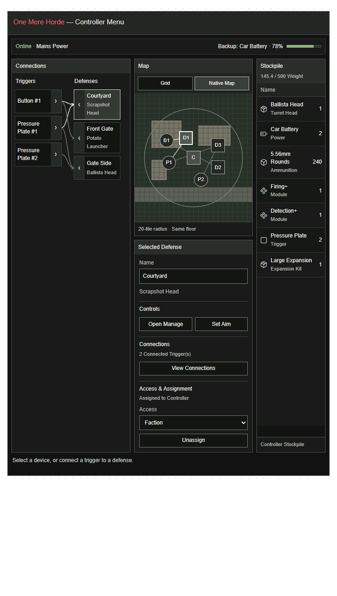
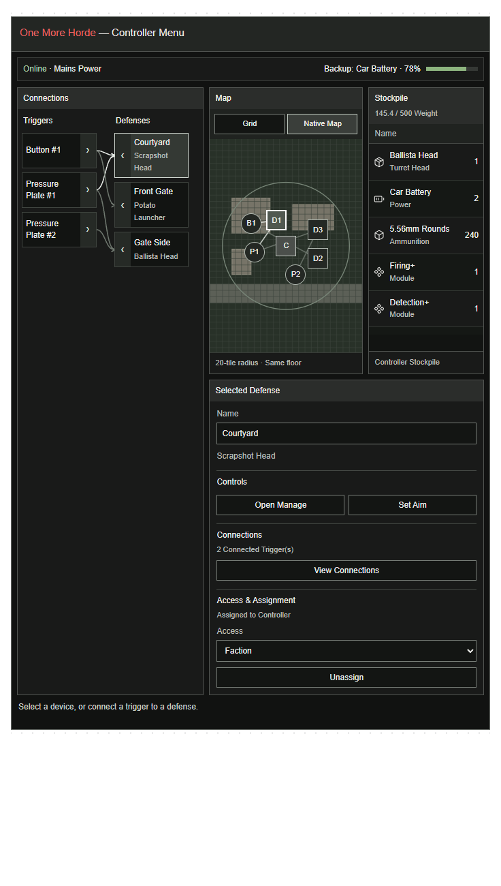
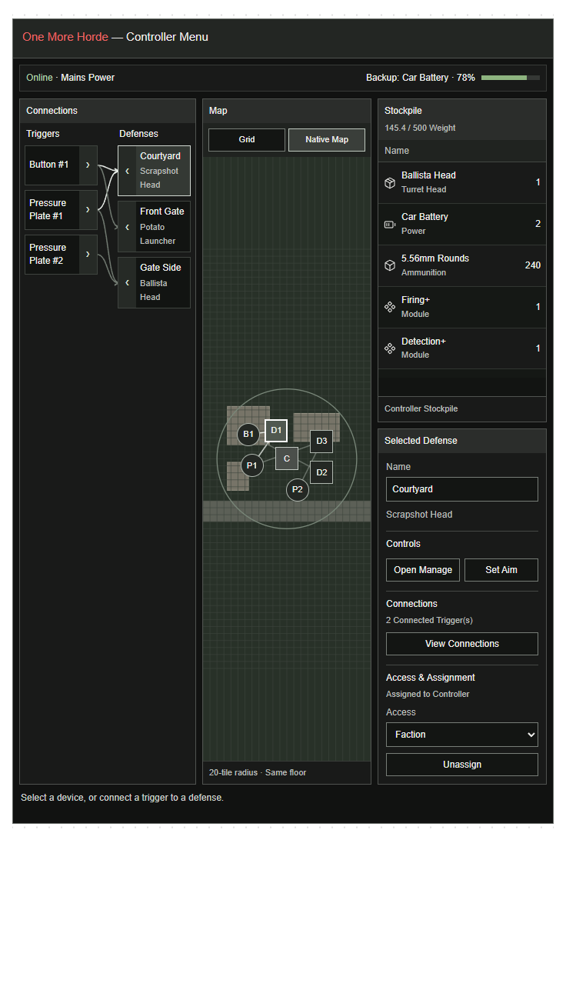
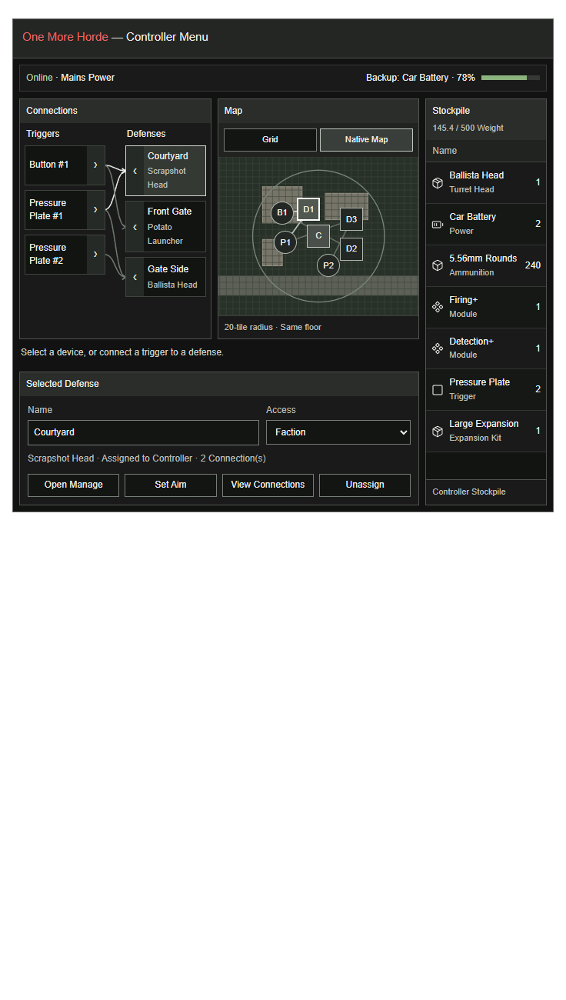
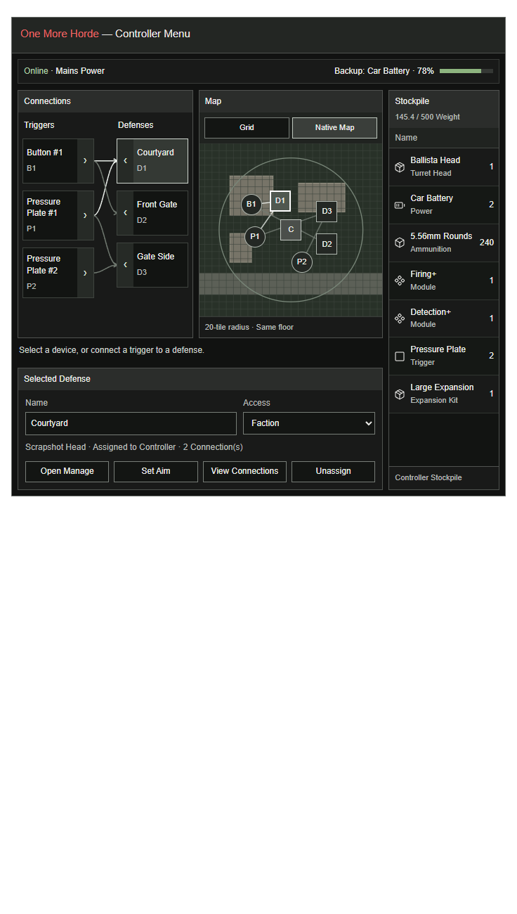

# C316 — Controller map and connection-view discussion

## C322 — Resizable Controller and Turret Manage menus (2026-10-18)

Owner asks to add resizing to both menus, allowing compact and expanded layouts without cropping or breaking controls, with module slots able to shrink. Owner requests agreement and the next-update recap. Add this to the planned patch; this turn records feasibility and behavior, not a gameplay implementation or new test build. C321 remains the expanded Controller arrangement.

### Resize behavior

- Give both menus a visible native-style bottom-right resize grip and retain their separate title-bar dragging area. Bound the size to the player's available viewport and a content/font-aware minimum. Reflow sections and wrap readable labels; do not uniformly scale text or allow controls to overlap. Check both horizontal and vertical bounds, including split-screen viewports and larger UI fonts.
- Manage: module tiles and icons shrink/grow within usable limits, then reflow into a suitable number of columns while preserving slot order, identity, rarity styling, tooltips and drag/drop targets. All slots remain reachable. Equipment/Ammunition can rearrange at compact widths; Load Order, Reload, power, range and Lure controls remain usable. Layout resizing never changes installed items or capacities.
- Keep Manage's existing no-whole-menu-scroll direction. Details grows the menu only when needed and space permits; at tighter sizes retain the existing dedicated Details page fallback. Load Order remains its full-menu page. User-selected size is not overwritten by routine state refreshes; expanding/collapsing details must not create cumulative height drift.
- Controller: preserve Connections on the left, wider Map above Selected Device, and full-height Stockpile on the far right when space permits. Compact widths rearrange these sections with a usable minimum size; do not hide essential actions. Keep Connections and Stockpile independently scrollable and reuse the existing native-backed Stockpile widget. Controls, Connections, and Access & Assignment remain separate groups.
- Remember geometry separately for Controller and Manage on the local client using native layout persistence, with player-specific keys and screen bounds checked on restore. Restore size/position only after a valid menu open, not visibility or a stale world object. Resizing must not recreate inventory panels, lose selection, change map focus/zoom or issue gameplay/network commands. A changed viewport safely reclamps the saved geometry.
- Recalculate layout when dimensions/font/content mode change, coalescing drag updates; retain cached map/device/inventory data. Recompute hit regions and connection anchors with geometry. Do not add per-tick world scans, inventory enumeration, or disk writes during dragging. Mouse release outside the window, closure and interrupted gestures must release capture cleanly.

### Source evidence and acceptance

Installed Build 42.21 `ISUI/ISResizeWidget.lua` (`resize`, `onMouseUpOutside`, `new`) supplies a native resize control, minimum dimensions, a custom resize callback and capture release. Its built-in clamp only handles the global screen's lower edge: our callback must additionally account for viewport width, player bounds and layout minima. `ISUI/ISLayoutManager.lua` (`RegisterWindow`, `DefaultSaveWindow`, `DefaultRestoreWindow`, `TryRestore`) supports geometry persisted in `layout.ini` by screen resolution; use custom save/restore callbacks to avoid restoring menu visibility or stale device references.

Current `TurretManageLayout.create` computes widths and a fixed module grid at creation; `refresh` keys its layout cache on screen height/content and sets menu height automatically. `ControlPanelLayout.create` similarly initializes dimensions, while `refresh` only keys on selected kind/assignment. Both need a geometry-aware layout pass; attaching a grip alone would leave children at stale sizes. This is static source verification only. No new Lua/native/connected-MP test was run for the unimplemented feature.

Before packaging, verify compact/normal/expanded bounds, all 16 module slots, large fonts, Details/Load Order/Lure modes, long names, full Connections/Stockpile, resize during selection/drag, release outside, reopen and restart persistence, changed resolution/player viewport, and remote Manage inventory/authorization behavior. Resize should generate no gameplay packets or extra state scans. Preserve the no-pcall gate and all existing server-authoritative actions.

### Next patch recap

- Controller Map and Connections redesign
- Grid / Native Map toggle
- Drag-to-connect controls
- Resizable Controller and Turret Manage menus
- Adaptive module grid and saved window sizes
- Unique device names and numbering
- Left-click Buttons and temporary light-switch graphics

No unresolved design choice is needed for this resize addition. Full integration still requires native layout and connected-MP validation; no gameplay acceptance is inferred from the earlier browser mockups. Installed 0.2.54.1 is unchanged. **Wait for a patch.**

## C321 — Full-height Stockpile on the right; wider Map (2026-10-18)

Owner requests: “Let's move Stockpile over to the right, and open the map to fill the space where stockpile used to be. Stockpile will extend down, next to the Selected Defense, similar to before.” This supersedes C320's Stockpile placement: **Connections fills the left column; the wider Map sits above Selected Device in the center; Stockpile fills the far-right column beside both.** All three columns share their outer top/bottom edges. Retain separated Controls, Connections, and Access & Assignment groups, head subtitles, grey styling and Grid / Native Map.

Connections and Stockpile each scroll independently without expanding the menu or shifting details. Keep the 40% list-width preference within the Map/Connections area with a readable minimum; narrow previews stack the regions. The existing native-backed Stockpile remains the implementation target, not a replacement inventory system.

Browser checks pass for the requested geometry, increased Map width, bounded overflow in both lists, wire alignment during scrolling, action groups, selection, linking/disconnection, Manage handoff, responsive widths 1040/736/390/320 and real touch events. Visual review caught an awkward split in a device name at inline width; a modest minimum-width increase corrected it before final checks. No page errors. [Checks](../diagnostics/controller-c321/checks.json) and [preview source](../diagnostics/controller-c321/preview-source.html).

Planning/preview only. Installed 0.2.54.1 and all pending C318 gameplay requirements remain unchanged. No native-game or connected-MP acceptance claimed. **Wait for a patch.**

## C320 — Details beneath Map and Stockpile; scrollable Connections (2026-10-18)

Owner clarifies: “I meant have selected defense go under the map as well. We'll give Connections a scroll bar, similar to the stockpile.” This corrects C319's interpretation: **Connections fills the left column; Map and Stockpile share the upper-right row; Selected Device spans the full width beneath both Map and Stockpile.** Retain Controls, Connections, and Access & Assignment as separate groups. The matching preview input changes list width to **40%**.

Connections has one bounded vertical scroll area for both Triggers and Defenses and their connecting lines. Column labels stay visible while scrolling. Its scrollbar uses the same styling as Stockpile; with only the three sample rows it has no overflow to traverse. Long lists must not stretch the menu or move the right panels, and the lines must remain attached to their row ports. Desktop Connections extends to the details panel's bottom edge; on narrow previews the regions stack while preserving Map/Stockpile before details. Native game integration must preserve the existing authoritative actions and Stockpile implementation.

Verified the corrected panel bounds, separate action groups, head subtitles, long-list overflow with fixed right-panel position and aligned wires, mouse/tap linking, selection, disconnection, map toggle, Manage handoff, real mobile touch and no horizontal overflow at 1040/736/390/320 widths. An initial overflow test caught content stretching the menu; size containment fixed it. One subsequent browser run reported an intermittent `detectOverflow` error; a fresh run with stack capture passed without recurrence. Do not treat preview checks as native game or connected-MP acceptance. [Final checks](../diagnostics/controller-c320/checks.json) and [preview source](../diagnostics/controller-c320/preview-source.html).

No gameplay/install/version changes. C318 naming and Button corrections remain pending. Save and mirror this clarified layout without asking the owner to reapprove the same direction. **Wait for a patch.**

## C319 — Right-column details and restored action groups (2026-10-18)

Owner asks to move/extend Selected Device to the right beneath Stockpile, extend Connections downward to the bottom, and allow a taller menu. Owner reiterates the accepted Grouped design: Open Manage and Set Aim must not share one action row with View Connections and Unassign. This correction supersedes C317/C318's below-map details placement and mixed action row, not the selected Triggers / Defenses names, simultaneous map/lists, head subtitles, grey theme or existing Stockpile implementation.

The updated preview places Stockpile above Selected Device in a wider right column. Connections and Map fill the left area down to the Selected Device bottom edge. Details contain Name/head identification followed by separated **Controls**, **Connections**, and **Access & Assignment** groups; Open Manage/Set Aim, View Connections and Unassign occupy their corresponding groups. Enabled controls retain explanatory tooltips. The submitted list-width tweak of **43%** is retained, subject to a readable minimum width. On narrow preview widths regions stack; Selected Device stays below Stockpile.

Stockpile keeps its familiar inventory styling and a bounded independently scrolling inventory list on desktop; the surrounding menu is taller. This represents the existing native-backed inventory widget, not approval for a replacement storage system. Actual game dimensions must fit the available screen/UI scale rather than copy browser pixels literally. The map drawing is positioned independently of intrinsic SVG size to avoid the preview increasing its own height during layout refreshes.

Verified in the browser: right-column placement beneath Stockpile, matching bottom edges, exact action-group membership, retained head subtitles, selection, Grid/Native Map, mouse drag/tap connection, disconnection, Manage handoff, real mobile touch, and no horizontal overflow at 1040/736/390/320 viewport widths. [Checks](../diagnostics/controller-c319/checks.json) and [editable preview source snapshot](../diagnostics/controller-c319/preview-source.html). The sample map remains schematic; no native rendering or connected multiplayer acceptance is claimed. C318's naming/Button fixes remain required and unimplemented in installed 0.2.54.1.

Planning/preview changes only, mirrored through the existing development PR. No gameplay version/install, Workshop upload or merge. **Wait for a patch.**

## C318 — Visual approved; identity and Button corrections (2026-10-18)

Owner approves the visual, requests more compact Connections with the equipped head below each defense name, and asks to confirm unique names, duplicate numbering, first Button #1 and left-click activation. Owner also authorizes a temporary native light-switch graphic. This settles the visual review requested in C317. The requests are recorded for the next gameplay patch; this checkpoint audits source and updates the preview, without changing the installed build or claiming the missing behavior already works.

### Verified current gaps

- `ControlClient.name` (line 57) returns custom names unchanged. Automatic turrets append `state.number` without a #; Button and Plate return their generic translated kind. A new Button currently displays **Button**, not Button #1.
- `ControlWorld.number` (line 618) only allocates a number after Controller assignment, within that Controller and head family. Separate Controllers, unassigned turrets, renamed devices and head/assignment changes do not satisfy world-wide unique display naming. `ControlAction` validates name length/control characters but does not resolve duplicates.
- `ControlWorld.register` already assigns independent `control-<serial>` keys and preserves a recovered control ID; links use these keys. Bed, barrier and barbed records have separate private IDs. These identifiers must remain distinct from editable display names. Passive trap menus currently show type/facing or local selection numbers rather than persistent unique labels.
- `ControlClient.world` queues `Pulse` through **right-click / Press**. No Button left-click hook is registered there; the existing `OnObjectLeftMouseButtonDown` callback in `TurretRange` selects turret ranges. Therefore left-click Button activation cannot be confirmed in 0.2.54.1.
- `OMHTT_Controls.txt` currently uses radio sprites for Button. Installed 42.21 `newtiledefinitions.tiles.txt` defines **lighting_indoor_01_0 through _3** as Light Switch, attached N/W/E/S respectively. This is grounded asset evidence, not rendered acceptance or proof that swapping a sprite cannot inherit native light-switch interaction.

### Required next-patch behavior

- Give every placed turret, trap and trigger an unambiguous display label independent of Controller membership. The first newly created Button in a fresh world is **Button #1**, subsequent Buttons #2, #3, etc. Other families likewise receive numbers; numbering must not restart at each Controller or collide with unloaded devices.
- Keep actual connection/network IDs unchanged. Store display identity authoritatively; preserve it across save/reload and pickup/replacement. Turret automatic names use their equipped head with the turret's reserved number; changing a head does not change its underlying ID. Controllers retain their existing generic menu title and do not gain a rename requirement.
- Resolve duplicate custom names with a numbered suffix, treating surrounding whitespace/case as equivalent for conflict checking. Do not rename the original to accommodate a later duplicate. Resolve pre-existing duplicates deterministically once, not whenever a menu opens; retain reservations for packed devices. Naming indexes are updated on placement/rename/head change, with no per-frame world scan.
- Left-click the **world Button** to queue one existing authoritative Pulse with native approach/reach validation. Retain right-click Press as a fallback. UI marker clicks select a device and must not fire it. Do not bypass permissions or send both native-light and OMHTT actions from one click.
- Use the native light-switch graphic only as a temporary Button appearance; retain the momentary fire signal. Verify wall orientation, object picking, non-obstruction and interaction behavior in the installed engine before packaging. It must not become a permanent on/off switch or operate room lighting.
- Compact Connections rows and spacing; show defense name followed by the equipped head in smaller muted text. The preview reduces the desktop row minimum from 64 to 52 px and the workspace minimum from 346 to 306 px. Retain usable link handles and touch targets; long head names can wrap rather than disappear. Preserve the existing Stockpile and selection/details behavior.
- Passive traps receive identity labels without silently gaining controller receiver behavior. Implement through each family's existing authoritative persistence path, not by turning every trap into a ControlWorld turret.

### Verification and delivery boundary

Revised preview checks pass: all three head subtitles, shorter desktop rows, selection/focus, map background toggle, mouse drag and click/tap linking, disconnection, Manage handoff, real mobile touch and no horizontal overflow at 1040/736/390/320 widths. [Check evidence](../diagnostics/controller-c318/checks.json). Source findings above are a static audit, not an in-game Button test. No shipped Lua changed, so no new Lua/native runtime pass or connected-MP claim is made. Before gameplay delivery, test duplicate placement/rename, head swap, reassignment, pickup/reload, simultaneous MP requests and exactly one Pulse per click.

Current 0.2.54.1/tag/archive remains the saved baseline. No Workshop upload, merge or package/version change in this planning checkpoint. **Wait for a patch.** No additional design approval is requested for the already-approved visual.

## C317 — Direction selected and interactive layout prepared (2026-10-18)

Owner selects **1B, 2B, 3A**: **Triggers / Defenses** names; **both connected lists beside the map simultaneously**; **Grid / Native Map** background toggle. These selections supersede the earlier recommendations for Inputs/Outputs and mutually exclusive Map/Connections views. Do not quietly restore those rejected recommendations.

The preview places the two connected lists together at the left, the map beside them, and the existing-style Stockpile at the right. Selected-device details occupy the area beneath lists/map instead of a fourth permanent column. On a narrow browser preview the regions stack while staying present; this is preview readability, not an approved change to the desktop game's layout. The Stockpile remains the existing native-backed implementation when production work is approved.

The interactive preview supports list/map selection, focus highlighting, Grid/Native Map background switching, mouse-drag and two-tap connections, selected-link disconnection, name/access controls, assignment intent, and a Manage handoff illustration. Set Aim represents the existing world-aim workflow. Sample devices, inventory and schematic map buildings are illustrative, not a capture of the user's save or proof of native rendering. Stockpile transfers and the real Manage menu are not reimplemented in this mockup.

The current 0.2.54.1 menu/tag/archive remain intact. The owner has chosen the design direction, not approved a gameplay patch. **Decision needed: review the concrete layout before production implementation.** No native game or connected multiplayer result is claimed by these preview checks.

Preview checked in headless Edge: selection/focus, background switching, click/tap and drag connections, Disconnect, Manage handoff and actual touch events passed. No script errors or horizontal overflow at 1040, 736, 390 and 320 browser widths. Native integration and in-game rendering remain future work. [Preview checks](../diagnostics/controller-c317/checks.json).

Local editable conversation preview: `C:/Users/bandi/.codex/visualizations/2026/10/06/01a11283-2701-7630-a9bf-aac054c7bf3c/controller-map-and-lists.html`.

## Status and preservation

Owner asks to consider a Controller Menu rework, explicitly follows with “Let's discuss,” and wants the current menu saved because it is good. Existing Stockpile appearance/behavior must be retained. This is planning only: no gameplay/UI implementation, new version, install, or new acceptance claim.

The current Grouped Controller Menu is preserved by immutable `test/v0.2.54.1` at `0a65f67ad2cd3a3eb0ff417ec7eae255e9b5ae1f`, the GitHub mirror, and the verified local `artifacts/OMHTT-0.2.54.1.zip` archive. A prototype must be separate from this baseline; preserving it does not require shipping duplicate UI implementations or a permanent legacy-mode setting.

Owner proposes a grid map with optional satellite view, accurate trigger/turret positions, drag-to-connect links, clickable hierarchy that focuses/selects the map device, and device details including Name, Open Manage, Access and assignment. The supplied image groups Button #1 + Pressure Plate #1 over a shared output and another plate over two outputs. Owner then suggests two connected lists: Inputs/Outputs or Triggers/Turrets/Traps. Treat this as an alternative to the hierarchy, not an instruction to display all layouts simultaneously.

## Current evidence

Inspected installed Build 42.21 vanilla Lua: `ISUI/Maps/ISMiniMap.lua` constructs `UIWorldMap`, loads map data/images, uses world/UI coordinate conversion and center/zoom methods. Accurate icon placement, selection and focus are technically grounded; production integration and rendered acceptance are not yet tested.

`ISMiniMap.lua` line 10 sets `TERRAIN_IMAGE = false`; the disabled branch at lines 304–332 includes a terrain-image toggle using `ImagePyramid`, `newPyramidLayer`, and `pyramid.zip`. The installed Muldraugh map includes those packaged image files. This supports investigating a textured background, not promising it works or depicts current player-built walls, interiors or changes. A live world camera would be separate, substantially more involved work; no verified live-satellite implementation is claimed. Ordinary native map layers are the lower-risk first approach. Preserve map-mod fallbacks and existing visibility/access policy.

Current `ControlWorld.link` accepts Plate/Button inputs and Turret receivers. Passive traps are not newly made controllable by a UI change. Only supported receivers belong in the connectable Outputs list; Traps can become a subtype when an actual receiver contract exists. Preserve the 20-tile same-floor rules, 32-input/32-output caps, Firing requirement and current signal semantics. Multiple inputs retain existing any-input behavior, not new AND logic.

## Recommendations awaiting decisions

**1 — Names.** Recommend **1A Inputs / Outputs**, with Buttons/Plates and Turrets/future supported Traps as types within the lists. **1B Triggers / Defenses** is friendlier wording but less general for future signal devices. Three separate Triggers/Turrets/Traps lanes are not recommended: receiver type should not change the connection model.

**2 — Layout.** Recommend **2A Map / Connections views occupying the same main area**, retaining selection and links when switching; the existing Stockpile remains at the right, with selected-device information beneath the main area. Connections shows Inputs on the left and Outputs on the right; each device appears once and can have several connections. Map shows accurate positions and clicking/focusing behavior. A Find on Map action switches views and centers the selected device. **2B Lists and map visible together** trades immediate cross-reference for less map/detail space and more clutter, especially with Stockpile open. Avoid adding a fourth permanent information column.

**3 — Background.** Recommend **3A Grid + native map toggle** first. **3B Investigate the disabled textured terrain-image mode before choosing the background**; probe results must be discussed before calling it supported. Static map imagery is not a live snapshot of player construction.

Proposed interaction default: click a marker/list row to select; drag from a visible connection point to a valid receiver, with select-input/select-output fallback. Blank map drag pans; device gestures do not move world objects. Emphasize selected connections, show direction and current signal state, and offer explicit Disconnect on a selected link. Duplicate links are rejected. Grouping/selection does not change signal behavior or assignment automatically.

## Performance, compatibility and scope

Reuse the existing device IDs, synchronized state, remote authorization and native timed-action mutation path. Render the map/list locally while the menu is open; cache device and connection layouts and refresh changed data at the existing bounded cadence. Do not scan the world or rebuild the graph every frame. Drag preview stays local; one accepted drop submits one link action, and the server rechecks permissions, proximity to the Controller, power, range, assignment and receiver compatibility. Concurrent removal/access changes must cancel or reject stale interactions clearly.

Receiver links, Controller assignment and access are distinct; the UI must label these clearly. View changes must preserve selected device and the Stockpile widget, not open a second independent inventory system. Do not add live zombie tracking, multi-floor control, passive-trap powering or new logic gates under this redesign.

Once the owner selects the layout/background direction, prepare a focused interactive mockup before approving production code. For a later implementation, high reasoning is appropriate for native map input/MP/UI integration; use Fast if the planned implementation exceeds 25 minutes. No model setting was changed.

## C323 - Implementation approved (2026-10-18)

Owner: "Approved." This authorizes the complete C318-C322 recap: native resize grips, responsive layouts, local geometry persistence, selected Controller map/list/Stockpile arrangement, unique display names and Button corrections. Existing server-authorized actions and native inventory integration are retained. Verification, immutable packaging, installation and the standing C108 development mirror are required. Rendered and connected-client acceptance remain distinct from automated evidence.

### C323 implementation and verification

Implemented as 0.2.55; see [patch](PATCH_v0.2.55.md) and [verification](TEST_v0.2.55.md). Compact Controller widths retain the attached native Stockpile page, while normal widths use the accepted three-region arrangement. Selection, map focus and inventory widgets survive geometry changes. Legacy Button sprite definitions remain available for loading before migration. The prior 0.2.54.1 test tag/archive remains the rollback snapshot. Rendered and connected-client acceptance is still pending.
