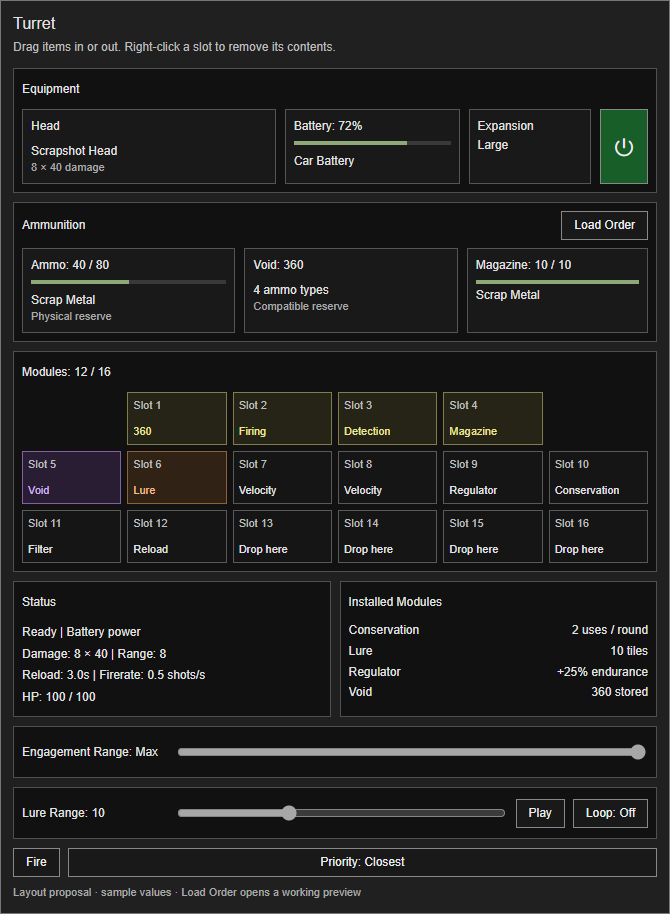
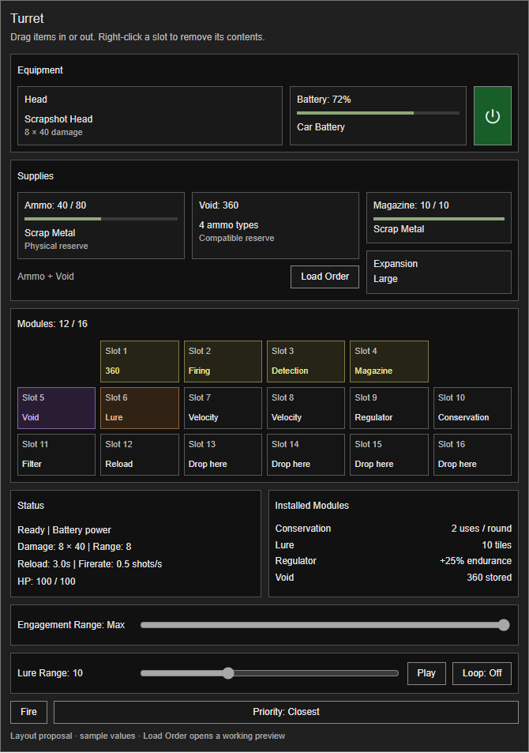
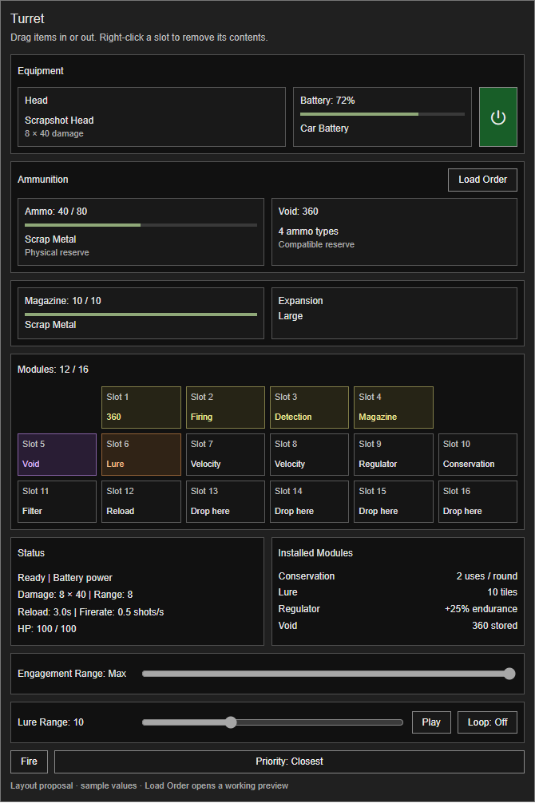
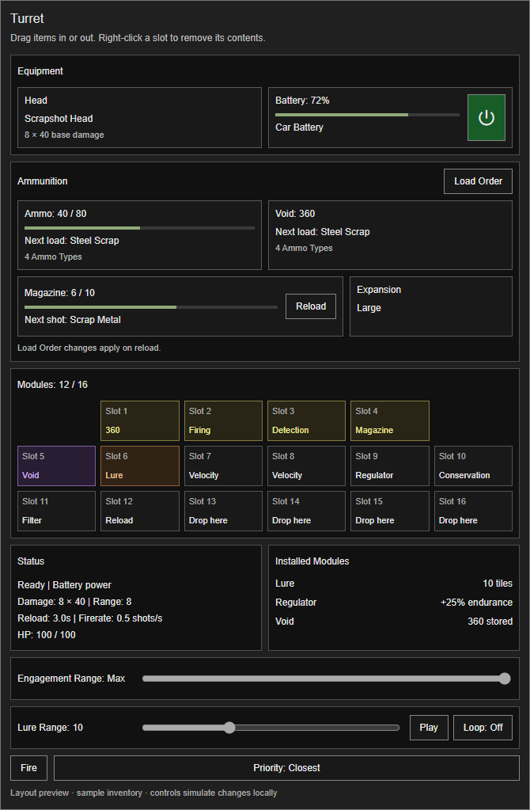
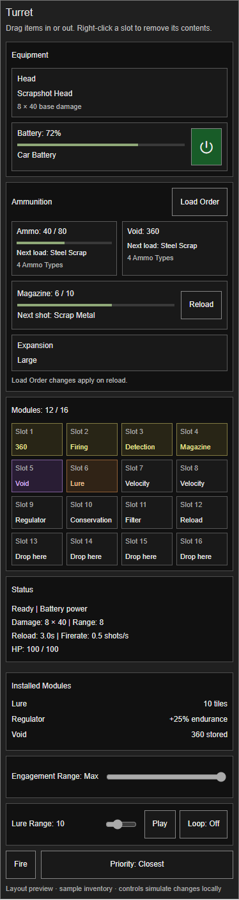
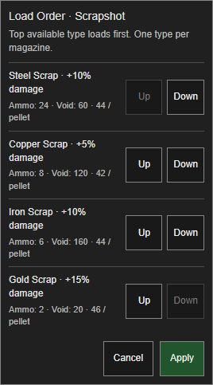
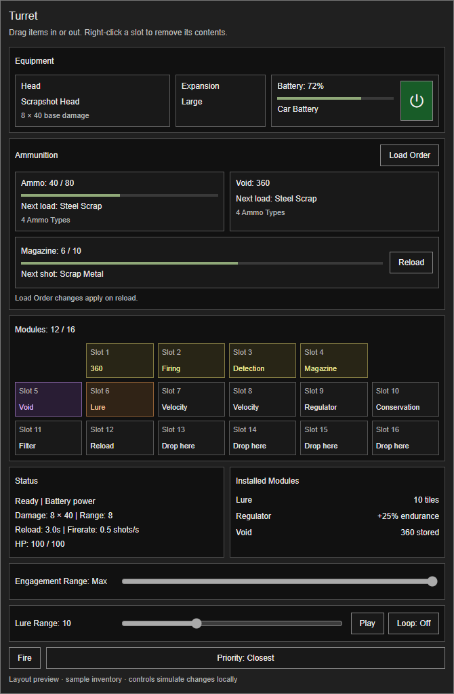
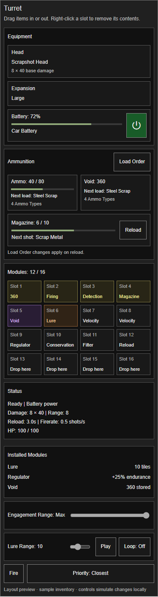

# C263 — 0.2.51 owner findings and correction choices

2026-10-15. Owner reports loud Makeshift Bombs, overlapping Lobber shots before detonation, unstable-looking physical scrap capacity, missing scrap variants, cramped Manage, Load Order needs, missing head reload audio, wrapped tooltip color loss and unnecessary rotary rate wording. Attached mockup places Load order inside the Ammo panel. All eleven points below are retained. This is investigation/planning, not a newly installed patch or blanket owner pass.

## Captured evidence

Root OMH.cmd captured console.txt and installed manifests at `diagnostics/captures/20261015-233602-4452`. Console SHA256 `70bc8e918a88b581bcda01b33c07fe26e0a934f4e808b83e7643e4e28e238372`; loaded diagnostics show version0.2.51, sideSP. No T&T Lua exception was found in the inspected capture. Native/map and other-mod warnings remain; they are not evidence of T&T failure. Raw console stays local.

## Findings and requested fixes

1. `TurretOrdnance.step` uses PipeBombExplode for every primary and mini grenade. Audible gain and zombie-attraction radius are separate. Preserve attraction/damage unless explicitly selected otherwise. Native candidate auditions were rendered and checked non-silent; proposed choices below. Mini explosions also need reduced, bounded presentation to avoid a pile of full-volume pipe bombs.
2. Lobber cooldown3.5seconds is independent of travel at8tiles/second plus2second fuse. At18tiles that is approximately4.25seconds before normal collision/scatter/scheduler effects, so the second launch can precede detonation. Recommend per-turret pending-primary tracking: next firing cycle waits for all primary grenades from its prior volley to detonate or retire, and normal cooldown/reload readiness. Fragment children do not extend that gate. Preserve pause/persistence, cancellation and no-catch-up behavior; server owns completion. Do not use a guessed fixed delay.
3. Scrapshot inherits potato capacity plus expansion bonuses, then hits native weight. It has no dedicated count cap. Owner requests roughly80 with Large Expansion. Native weight protection must remain:80 cannot guarantee space for arbitrary heavier mod items. Proposed total reserve ladder below; preserve current ten-round magazine and make reserve versus magazine semantics explicit.
4. Ammo.family currently accepts only Base.ScrapMetal. Installed42.21 scripts define AluminumScrap, CopperScrap, BrassScrap, IronScrap and SteelScrap at0.5weight versus ScrapMetal1.0; GoldScrap/SilverScrap are0.05. Broad hasmetal tags would accept unrelated metal objects. Use explicit native types and registered compatibility overrides for modded scrap; do not classify by item display-name substring.
5–6. Replace payload-specific controls with one Load Order editor opened from matching buttons in Ammo and Void. One order per equipped head/ammo family, shared across both sources, listing compatible type, physical/Void counts and Up/Down controls. Save on explicit Apply via validated server action. Proposed: skip unavailable types, retain preferences, append newly encountered compatible types predictably. The current loaded magazine semantics require a choice below. Do not maintain contradictory separate physical/Void orders.
7–8. Equal-width Ammo/Void inset panels with dedicated aligned footer buttons below the drop zone; increase Manage height where screen room allows, retain bounded layout/scrolling on smaller viewports. Do not overlay buttons on item icons/drop text. Owner's selected Inset panels variant and supplied screenshot inform functional layout only.
9. TurretReloadAudio explicitly skips Ballista; Lobber/Scrapshot use potato fallback. Add verified native per-head reload/start/finish cues tied to actual cycle transitions, including server-replicated playback with no duplicate host sounds. Rotary heads have no ammunition reload and should not gain a fake reload.
10. Remove new positive/negative colors from module descriptions; retain rarity color only. Prefer concise unwrapped feature/stack lines and text-sized tooltip width. The current native item tooltip wraps first, then recognizes positive/negative content per line, explaining white continuations.
11. Replace `Motor: %1 RPM equivalent` with `%1 RPM` in the Firerate field. Keep battery endurance units truthful; the owner's correction concerns firing-rate wording.

## Choices presented (proposals, not selected)

**1 — Makeshift explosion sound.** 1A recommended: native AerosolBombExplode at proposed35% gain; 1B: FireCrackerSingleExplode at35%; 1C: existing PipeBombExplode at20%. These are audition gains, not measured equal loudness or installed settings. Native pipe/aerosol payloads can retain their own identity; mini-grenade gain/voice limiting should prevent repeated full-volume booms. Local audition: `diagnostics/audio-audition/c263/SOUND_CHOICES.html`, evidence `audition.json`.

**2 — Scrap reserve cap.** 2A recommended: None/Makeshift/Small/Medium/Large =20/30/40/60/80. 2B: flat80 regardless of expansion, like the existing fixed spear cap. Both retain native weight protection and ten-round magazine; neither promises80 heavy mod scraps fit. Void remains weightless and does not inherit the physical reserve cap.

**3 — Scrap families.** 3A recommended: ordinary Scrap Metal plus aluminum/copper/brass/iron/steel; one item per shot, same damage. 3B: also accept gold/silver at the same damage, despite their much lower weight. Registered mod variants remain explicit, not all-metal wildcard acceptance. New material damage scaling is not inferred.

**4 — Applying Load Order.** 4A recommended: finish the current magazine, use highest-priority available type at the next reload. 4B: Apply requests a safe unload/reload immediately, so the next shot uses the selected available type; extra handling and exact-ammo refund/space checks required. Never transform loaded ammo in place or delete overflow. Both source buttons edit the same order, with server validation and head-change/concurrent-edit protection.

No Source/Contents edits, gameplay version bump, tag movement or installation this turn. C263 correction decisions precede implementation per the project owner-test agreement. R4C1 physical controls remain retained next, not silently dropped.

## C264 — selections, shared-button layouts and timing revision, 2026-10-16

Owner selects C2631B (single firecracker), 2A (20/30/40/60/80 reserve progression), 3B (include gold/silver), and4A (order changes at the next reload). Void remains the answer to physical storage constraints; native weight protection is retained. Owner proposes damage/stat bonuses for rarer scrap and asks to display each ammo's benefit in Load Order; exact bonuses remain unselected.

Owner corrects the duplicated-button proposal: one shared Load Order button near Ammo/Void, showing both sources. Requests layout mockups while retaining the liked inset-panel design. Owner asks whether magazines can mix ammunition, and rejects waiting for an explosion callback: shorten fuse and lengthen firing interval instead. This supersedes C263's recommended pending-primary firing gate; do not implement that gate as though it were accepted.

### Layout choices

- **1A / Shared header — recommended.** Equipment retains inset panels; Expansion joins the upper equipment row. A single Ammunition header button sits over equal-width Ammo/Void and the Magazine slot. Smallest height of the three.
- **1B / Shared footer.** Ammo/Void share a footer Load Order button; Magazine/Expansion are stacked beside them. Keeps Expansion near its current region but costs more height.
- **1C / Roomier rows.** Equal-width Ammo/Void occupy one row, Magazine/Expansion another. Clearest separation, greatest height; needs responsive scrolling on shorter game viewports.

These are functional layout proposals with sample values, not installed UI screenshots or new art direction. Interactive preview lives in the task-owned `turret-ammo-layouts.html`; browser checks passed all three Up/Down/Apply/reopen interactions, no script errors, and360px closed-layout horizontal-overflow checks. All three rendered images were inspected. No native game rendering is claimed.

### Mixed-magazine feasibility and choices

TurretFeed currently stores one `cycle.payload` and optionally one Void descriptor/module identity per loaded magazine, selects one physical/virtual source and charges Conservation debt by payload. The custom heads can support mixed magazines, but this requires a bounded ordered round/descriptor list and exact source/accounting changes; it is not a UI-only switch or an existing native feature. Preserve save/reload, pickup, head/module removal, MP authority, Conservation and Splitter accounting. Native firearm caliber/alternate-ammo support is not expanded by this proposal.

- **2A — recommended:** mixed magazines for our custom ammo heads. Fill by priority; if the first type runs out, top up with the next type. Example three-round Lobber: two Makeshift Bombs then one Pipe Bomb. No forced alternation or programmable patterns. A full magazine of the first type remains normal when enough is available. C2634A remains: changed order applies at the next reload.
- **2B:** retain one type per magazine for now, using the selected priority at every reload.

Per-projectile payload behavior must remain truthful when a mixed magazine crosses a type boundary during Splitter consumption; do not spend one type and report another. This is an implementation verification requirement, not approval of unlimited ammo conversion or new firearm compatibility.

### Lobber timing choices

Verified code: speed8tiles/second, fuse2seconds after landing, base interval3.5seconds, range18tiles, default RangeBonusCap10 (effective maximum28), hard non-firearm range cap30. Rapid-Fire and Enhanced Firing both reduce the interval. An intermediate commentary incorrectly said maximum24tiles; corrected to28 before final recommendations. Default maximum travel plus proposed1.25second fuse is4.75seconds. At the hard30tile cap it is5seconds.

Both choices propose fuse**1.25seconds** and base shot interval**5.5seconds**. This is ordinary mechanical timing, not an explosion-completion lock. Lag or delayed scheduler work can still cause occasional overlap; do not promise a strict event-order guarantee without the rejected gate.

- **3A — recommended:** allow speed modules to reduce the5.5second interval, with a minimum computed from configured effective range /8 +1.25 fuse +0.75seconds headroom. Compute/cache on configuration changes; never wait for actual detonation. At18tiles the floor is4.25seconds, at28 it is5.5, at30 it is5.75. This keeps some short-range speed benefit and prevents ordinary module-driven timing overlap. At the floor, additional speed modules give no Lobber cadence benefit; show that in applicability/effective stats.
- **3B:** fixed5.5second Lobber interval, with firing-speed bonuses disabled for that head. Simpler but reduces Rapid-Fire/Enhanced Firing usefulness;30tile custom range leaves0.5seconds nominal headroom.

### Scrap bonus choices

Use explicit material bonuses rather than silently assuming item weight or a single global loot rarity equals damage. Both options show the exact bonus in Load Order, keep one item per firing use and retain physical weight checks. Scarcer materials being stronger is a game-balance choice, not a claim about real material performance.

- **4A — recommended modest bonuses:** ordinary Scrap Metal/aluminum +0%; copper/brass +5%; iron/steel +10%; gold/silver +15%. Their lighter weights already benefit storage. Display per-pellet damage as well as the bonus where useful; base remains8×40.
- **4B:** same damage for all scraps in this correction patch; display Base/+0% and balance material bonuses separately.

Settled remaining fixes remain retained: new-head reload audio, taller bounded Manage layout, unwrapped white descriptions except rarity, and plain rotary RPM. No Source/Contents/version/install change in C264; selections and unselected options are mirrored under C108.

## C265 — layout, Reload and final correction selections, 2026-10-16

Owner selects C2641A with vertical-layout refinements, 2B (one ammo type per magazine), 3A without its proposed timing cap, and4A (modest material bonuses). Requests next loaded-shot/type-count feedback on Ammo/Void and a Magazine Reload button. Reports the prior preview could not be manipulated on mobile. These are design selections; this turn does not change Source/Contents, version, installed files or immutable test tags.

### Selected layout and feedback

Retain the native inset-panel style. One Ammunition header contains the shared Load Order button. Ammo/Void stay equal width; Magazine sits below them, with Expansion alongside where space permits. Power belongs beside Battery, not Expansion. Narrow preview stacks these rows; actual native game layout must stay within the viewport rather than blindly adopt a phone-height window. Preserve the 4/6/6 module arrangement in the desktop game layout.

Recommended precise wording: Ammo/Void show **Next load: [type]** and **4 Ammo Types** (singular for one), counting available compatible types in their respective source. Magazine shows the actual **Next shot: [loaded type]**. The shared priority resolves the next available load across both sources. Do not call a reserve candidate the next fired shot while a different magazine is still loaded. Empty/incompatible sources show no compatible ammunition. Preview values are examples, not a readout of the current save.

### Manual Reload and accounting

Owner requests Reload on Magazine; feasible with server validation and ordinary reload duration, applying the latest saved Load Order and preserving unused ammunition. Retain one type per magazine. Existing loaded type remains until a reload; Apply itself does not transform loaded rounds. Disable non-applicable/reloading/no-useful-action states. Reach, permissions, current head, inventory and concurrent edits must be validated on the server.

Read-only evidence: custom-head TurretFeed stores one cycle.payload and optional Void descriptor/module identity; ammunition is consumed when fired, so clearing a logical loaded cycle must NOT manufacture a physical refund. Native firearms actually contain loaded rounds and need their native/exact-item unload/reload handling; no UI-only count clearing. Preserve Conservation debt, cooldowns, pending work and Impact entitlement; a manual reload must not grant free ammunition or first-shot bonuses. This is implementation guidance, not runtime proof that a new Reload command already exists.

### Confirmed timing and material balance

Lobber fuse becomes1.25seconds and base firing interval5.5seconds. Normal Rapid-Fire/Enhanced Firing upgrades remain, with no new travel-based floor and no explosion-completion callback lock. Existing generic module limits remain unchanged. Base timing leaves nominal headroom at current range; speed upgrades can produce another launch before the previous detonation. That is the consequence of the owner's explicit removal of the proposed cap, not a guarantee of strict explosion-then-launch ordering.

Selected Scrapshot bonuses: ScrapMetal/aluminum +0%; copper/brass +5%; iron/steel +10%; gold/silver +15%. Base8x40 remains; show exact bonus and effective per-pellet damage in Load Order. Physical reserve20/30/40/60/80 and native weight checks remain; Void is weightless. C263/C264 sound, reload audio, white unwrapped tooltips except rarity and plain rotary RPM changes remain in the correction bundle.

### Revised preview and evidence limits

The prior preview was intended to be interactive, but its checks covered desktop clicks/narrow layout, not touch. The cause of the owner's mobile failure is unknown; do not claim a platform diagnosis or actual-device fix. Revised preview uses one selected layout, an inline Load Order editor and explicit44px Up/Down tap targets, avoiding reliance on dragging or switching layout variants.

Browser checks passed mouse input at736px and emulated touch taps at390px/320px: open, reorder Gold to top, Apply, next-load update with existing loaded type unchanged, Reload, loaded-type update and reopen with retained order. Equal Ammo/Void widths, no horizontal overflow with the editor open and no page script errors. Desktop and phone screenshots inspected. This is local UI simulation, not native gameplay, real inventory accounting, connected multiplayer or the owner's actual mobile app acceptance.

Decision provenance: owner explicitly requests Magazine below Ammo/Void, dislikes Power beside Expansion, selects1A/2B/3A without cap/4A, asks for Reload and reports mobile failure. Next-load versus next-shot wording and normal-duration reload mechanics above are assistant recommendations resolving those requests without changing the selected single-type magazine rule. No new gameplay balance question remains for this correction slice. Implementation and verification are next; no additional owner play session is requested here.

## C266 — Expansion in Equipment and mobile preview, 2026-10-16

Owner corrects Expansion placement: keep it in Equipment. Revised desktop row is Head, Expansion, Battery with adjacent Power; Magazine occupies the full row below equal-width Ammo/Void. Shared Load Order, Reload, next-load/next-shot and type counts remain. This supersedes C265's Magazine/Expansion pairing, without changing confirmed gameplay selections.

Owner still cannot manipulate the mobile preview. Emulated touch success did not establish actual app compatibility; the underlying cause remains unknown. Supply a static image alongside the corrected preview so interaction is unnecessary to review the layout. Rendered desktop736 and phone320 screenshots inspected; desktop/390/320 browser checks retain equal reserve widths, no page overflow and functional local Load Order/Reload simulation. No native-game or actual-mobile interaction acceptance claimed.

No Source/Contents, version, tag or installation change. The owner indicates this correction should settle the mockup; do not reopen settled choices or require another play test for planning. Implementation remains the next step, with C263-C265 corrections and multiplayer safety retained.
