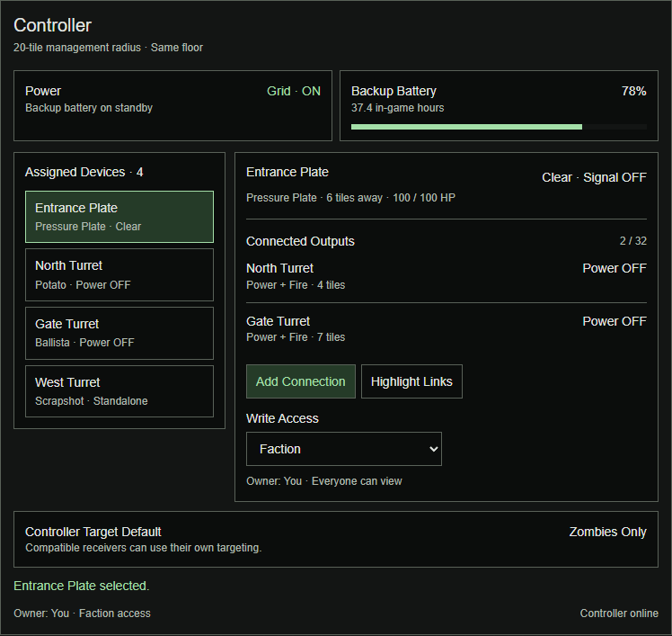

# R4C1 — buttons, pressure plates and links

**C309 / 0.2.53.11 installed:** [Inset pressure plates with press/release feedback](../PATCH_v0.2.53.11.md). Existing full-tile occupancy, filters, signals and passive collision remain. [Verification](../TEST_v0.2.53.11.md); R4C2 remains next content.

**C308 / 0.2.53.10 installed:** [Implemented corrections](../PATCH_v0.2.53.10.md): non-thumpable new/existing plates, contextual linking and Controller Set Facing. [Verification](../TEST_v0.2.53.10.md) separates automated/native checks from pending rendered/connected acceptance. R4C2 Poke Floor remains next content.

**C306/C307 update (2026-10-17):** SP plate activation is owner-confirmed. [Next-patch corrections and confirmed Controller Set Facing](../CORRECTIONS_C306.md) cover non-thumpable plates/future sensors, clearer linking and world-click direction. Owner selects 1A Set Facing with matching firing/detection sector and normal Detection tracking; Manual Aim Lock is not selected. Direction selection does not fire, and an OFF turret does not physically turn. Planning only; implementation remains queued. R4C2 Poke Floor remains next content.

**C302, 2026-10-17:** [Controller battery clarification and multiple deposits](../PATCH_v0.2.53.8.md). Ordinary Battery spares stay in the existing Stockpile; UI adds a native empty-slot silhouette, stored count and checked sequential multi-drop. No parallel drain, additional battery capacity, signal change or R4C2 expansion. Grey styling retained; rendered/connected verification remains pending.

**C294 / corrective build installed:** owner-approved C293 fixes are in [0.2.53.4](../PATCH_v0.2.53.4.md). Preserve defense-only storage, native inventory interaction and server authority; remote renewal no longer competes with item actions. Automated/native/release checks pass. [Evidence and held test](../TEST_v0.2.53.4.md); rendered/connected acceptance still pending.

**C293 corrective follow-up:** [Stockpile scope, capitalization and C292 solutions](../CORRECTIONS_C293.md). Defense-only admission remains; honor carried-bag withdrawal destinations, preserve native callbacks, invalidate automatic names, budget list finalization and bound remote renewal. Planning only; installed 0.2.53.3 unchanged and acceptance pending.

## C292 — deferred-test audit (2026-10-17)

[Five reproduced integration findings](../AUDIT_C292_v0.2.53.3.md) remain before corrective acceptance: native stockpile destinations/callbacks, unassigned auto names, Controller list work budget and remote-session renewal queues. Owner requests audit while unavailable to test.0.2.53.3 remains installed; R4C2 does not supersede these findings.

## C291 — management and stockpile correction (2026-10-17)

Owner authorizes the compact side-by-side management layout, working native child scrolling, accessible Details/Installed Modules, Enter/blur automatic naming, weight beside the name, removal of Controller naming, defense-supply stockpile admission and existing white-cube Controller presentation. [Patch/audit](../PATCH_v0.2.53.3.md) and [verification](../TEST_v0.2.53.3.md) supersede C290's failed rendered behavior. Preserve native inventory,500 stockpile limit, full contents weight, remote management and ownership/signal rules. R4C2 remains next after corrective acceptance.

## C285: implementation approved, 2026-10-16

Owner: “Looks good. Approved to patch. Implement the controller, pressure plates, updated menus, and ammo capacity changes. Keep multiplayer in mind and push it to GitHub.” This explicitly authorizes the approved C283 storage/capacity contract and C284 menu direction. Implemented in 0.2.53 with 20,807 assertions, native write/read and independent package checks. [Patch record](../PATCH_v0.2.53.md) | [Verification and short test](../TEST_v0.2.53.md). Rendered/connected acceptance remains deferred; no owner-test gate blocks delivery. No publication or main merge is authorized.

## C284: paired controller and turret Manage mockups, 2026-10-16

Owner requests controller and turret Manage mockups. Created a connected, responsive conversation preview and static screenshots, preserving the selected inset panels/shared ammunition header and C283 storage/ammo plan. No new design choices or gameplay implementation are inferred from the mockup request.

Controller: equipment/grid/backup and500-capacity stockpile, assigned-device list, selected-device status, full Manage entry, owner/private-faction-public access, connections and target controls. Turret: editable name/Auto, controller context, explicit controller-stockpile/player transfer source, Equipment with head/battery/expansion/power, weight warning, equal Ammo/Void panels under one Load Order button, full-width magazine/Reload,4/6/6 module grid, status/installed-benefits sections, Engagement Range and separate Lure controls. Mobile reflows to readable narrower rows. New-device-default access control placement is a UI proposal, not authority to change existing ownership defaults.

All names, stock quantities, weights, timing/stat summaries and rarity colors in this prototype are illustrative layout content, not game telemetry, revised tuning or proof of actual loaded capacity. Browser actions change only local preview state; they do not manage game devices. Native icons/assets are not recreated; this is functional UI planning, not final art. The head picker demonstrates another head configuration, not a verified live item transaction. Full runtime tooltip/stat/ownership rules remain governed by the existing contracts.

Headless browser checks passed controller-to-Manage navigation, naming propagation, local load-order movement, power feedback, module install/remove, source selection and bounded sample ammo loading, Lure toggle, no horizontal overflow at736/390/320 widths, and no script errors. Desktop/mobile/dark/light screenshots inspected; this does not establish phone-client interaction, PZ rendering, save/load, gameplay or MP acceptance.

[Controller preview](../mockups/controller-c284.png) | [Turret preview](../mockups/turret-c284.png) | [Controller narrow preview](../mockups/controller-c284-mobile.png) | [Turret narrow preview](../mockups/turret-c284-mobile.png).

Planning/mockup update only. No source/package/version/install changes; installed0.2.52 acceptance and C283 engineering verification remain pending.

## C283: storage route and full expansion progression approved, 2026-10-16

Owner selects C282 **1A and2A**. Controlled over-capacity storage of real items is approved for turrets and the controller; preserve full contents weight, turret ammo-family/count limits and the controller's500-weight stockpile limit. Native two-handed pickup applies when ordinary pickup cannot fit. This supersedes the earlier controller five-compartment proposal while preserving ownership, direct player/controller transfers and exact-item persistence requirements.

The entire C282 total-capacity table is now approved: potatoes100/250/500/750/1000; spears40/100/175/250/350; launchable bombs20/75/150/250/350; scrap20/200/400/650/900; ordinary firearm rounds250/1000/2500/3750/5000; shotgun shells250/400/600/800/1000, in no-kit/Makeshift/Small/Medium/Large order. Fixed balance values only, no day-length/RPM scaling. No-kit defaults and module-slot progression remain unchanged; retain saved Sandbox overrides with explicit compatibility handling.

No further owner design selection remains for this storage/ammo scope or the settled R4C1 controls foundation. Authority, over-capacity native serialization/replication, exact-item pickup/drop/deploy, forced-drop lifecycle, concurrent transfers, cached/bounded inventory work and independent packages remain implementation checks. Do not claim native heavy carry or full storage support has been integrated solely from this selection. Do not wait for deferred owner gameplay tests before future authorized implementation.

Void remains unchanged, all ammo remains real outside Void, no contents-weight reduction, no automatic resupply, no battery/durability rebalance. Poke Floor balance/recipe remains separate R4C2 work. Planning selections recorded; no gameplay/version/install/test changes this turn. Installed0.2.52 acceptance remains deferred.

## C282: remaining decisions scoped to storage and expansion progression, 2026-10-16

Owner asks whether anything else needs deciding. No new implementation/storage selection is inferred from this question. R4C1 signal/access/recipes/controller range/power/naming choices remain settled; Poke Floor content remains a separate R4C2 discussion and does not block existing receivers. Save/load, concurrent MP transfers, native heavy pickup/drop, large-inventory performance and package independence are implementation verification, not extra owner design decisions.

**1 — Storage approach (last turn's unanswered proposal). 1A recommended:** controlled over-capacity native real-item inventory for turrets, native two-hand pickup when ordinary pickup cannot fit; use the same approach for the controller while retaining its selected500-weight stockpile limit. This explicitly replaces the five-compartment implementation proposal while preserving capacity/source/ownership design. Keep full actual contents weight, bounded authorized transfers and warnings. **1B:** retain normal native storage admission; the approved large ammo ceilings may not physically fit, and loading them is not claimed supported. No virtual conversion, generic-container override or automatic resupply is included.

**2 — Lower expansion tiers. 2A recommended:** rebalance the complete fixed progression using the proposed table below; preserve current no-kit defaults and approved Large limits. **2B:** increase Large only, leaving lower tiers at their current limits; simpler balance change but a large last-tier jump. Counts are total allowances, not added bonuses, and do not change module-slot progression.

| Ammunition | No kit (unchanged) | Makeshift | Small | Medium | Large (approved) |
| --- | ---: | ---: | ---: | ---: | ---: |
| Potatoes |100 |250 |500 |750 |1000 |
| Spears |40 |100 |175 |250 |350 |
| Launchable bombs |20 |75 |150 |250 |350 |
| Scrap |20 |200 |400 |650 |900 |
| Ordinary firearm rounds |250 |1000 |2500 |3750 |5000 |
| Shotgun shells |250 |400 |600 |800 |1000 |

These lower-tier numbers and storage choice are proposals only. Owner's current defaults may be overridden by saved Sandbox settings; implementation must preserve overrides and reconcile exposure rather than blindly overwrite saves. Real contents are preserved when swapping heads or reducing capacity; established admission/service checks must not delete excess ammo. Void remains unchanged and portable/weight-free; battery/condition balance and automatic controller refill are outside this scope. No further generic design questionnaire should be inserted after these two selections unless implementation reveals a concrete gameplay tradeoff.

Documentation only, no version/install/tests;0.2.52 acceptance deferred.

## C281: ammo defaults approved; controlled over-capacity storage investigation, 2026-10-16

Owner accepts C280's proposed defaults and asks how heavy-object lifting permits more than100 weight. Approved Large ceilings:1000 potatoes,350 spears,350 launchable bombs,900 scrap,5000 ordinary firearm rounds,1000 shotgun shells. Fixed balance only; lower-tier progression remains unsettled. Rotary heads remain ammo-free. No Void retirement, weight reduction, battery rebalance or completed implementation is implied.

**Correction to prior capacity statements:** native getCapacity clamps are hard bounds on reported/effective normal capacity, not an absolute prohibition on storing more items. Current installed projectzomboid.jar ItemContainer.AddItem(InventoryItem) bytecode directly adds the exact item (duplicate-ID guard, parent/process/hot-save updates) without calling hasRoomFor/getCapacity. Existing turret loading explicitly checks native hasRoomFor in TurretTransferAction and native free weight in TurretCapacity. Thus the ordinary admission path blocks overfill, but an explicitly controlled mod transfer path may admit over-capacity real items. C274-C280 wording must not be read as proof that multiple compartments or virtual storage are the only solutions. No global inventory override or capacity-setter spam is needed for this candidate route.

Current installed ISEquipHeavyItem.complete moves the exact item to player inventory without ordinary room admission and equips both hands, using server completion/sync helpers. Native heavy tag/forced-drop integration provides transport behavior, not expanded storage itself. The placed turret still needs conversion to its existing portable exact-item representation before heavy equip; this is not a direct call on an IsoObject. Preserve full contents mass and normal encumbrance;700 weight of spears does not become comfortably portable merely because equip succeeds.

**Recommended implementation candidate, not proven/approved as a storage redesign yet:** keep one real native inventory; apply turret-specific ammo/head/expansion count limits through validated server transfers, permitting deliberate native overfill only for these containers. Reuse bounded transfer batches and cached summaries for large stocks; ordinary unrelated containers retain normal capacity checks. Route Manage, direct inventory drag/drop and controller loading through equivalent validation, with ordinary player/source eligibility, authorization, item ownership, transfer rollback and concurrency protection. Do not globally skip hasRoomFor or erase unrelated constraints. Show actual weight with an overweight/heavy-carry warning; use normal pickup when eligible and native both-hands carrying otherwise, with exact-item preservation and forced-drop handling. On configuration reduction preserve/unload surplus rather than delete it.

Required proof before claiming compatibility: actual over-capacity real-item add/serialization/reload, world-to-portable-to-world contents/IDs/condition, death/logout/vehicle-entry/hand-change forced drops, MP authoritative add/remove replication and concurrent servicing, and acceptable loading/UI latency. Current source/bytecode inspection proves the existence of the unchecked native add path, not successful full turret integration or multiplayer acceptance. This candidate is simpler than the earlier proposed controller compartments; replacing C275's selected compartment architecture needs explicit reconciliation, not silent implementation.

No gameplay files/version/install changed. Installed0.2.52 owner tests remain deferred. Exact capacity defaults are approved; transport/storage route remains engineering/design follow-up.

## C280: fixed balance selected and per-head ammunition estimates, 2026-10-16

Owner selects C2791B, explicitly rejecting exact programmed endurance: use fixed capacities as balance, and provide per-head estimates plus thoughts on guns. Supersedes C279's recommendation to scale allowance with day length or current weapon timing. The selected reference remains90-minute days/eight in-game hours =30 real minutes. No runtime capacity estimator or day-length-dependent limit is approved.

Inspected current TurretStats, TurretHeads, TurretCycle, Firearms profiles and TurretBatteryEstimate plus installed generated weapon scripts. Steady-cycle arithmetic:1800 / (cadence + max(0,reload+rack-cadence)/magazine), one ammo per shot, ordinary firing, no efficiency/speed/loaded-capacity upgrades. This approximates the existing finite-duration estimate; initial magazine/chamber and tick/aim delays can shift results slightly. Source-derived estimates, not a measured uninterrupted30-minute gameplay test.

| Head/example | Approximate ammo for30 real minutes | Proposed rounded Large limit |
| --- | ---: | ---: |
| Potato |900 potatoes |1000 |
| Ballista |300 spears |350 |
| Grenade Lobber |328 launchable bombs |350 |
| Scrapshot |858 scrap items |900 |
| Rotary Bat / Blades |0 |Not applicable |
| Native M9 pistol |2295 rounds |See shared firearm proposal |
| Native M14 semi-auto |1700 rounds |See shared firearm proposal |
| Native M16 auto |4189 rounds |See shared firearm proposal |
| Native pump shotgun |874 shells |See shared firearm proposal |
| Native bolt-action rifle |822 rounds |See shared firearm proposal |

Gun examples use installed script recoil/magazine values and current adapter reload/rack values: M9 15/.5333s/2.7s+1.6s; M14 20/.8889s/2.7s+1.6s; M16 30/.2963s/2.7s+1.6s; Shotgun5/1.3333s/(5*.833s)+.8s; HuntingRifle4/1.6s/(4*.590s)+1.6s. Ordinary chambered baseline, not Enhanced Firing or native handheld RPM. Modded guns may differ. Initial chamber convention does not justify presenting exact counts as guarantees.

Recommendation, not approved: fixed Large allowance5000 ordinary firearm rounds and1000 shotgun shells, preserving distinct custom-head allowances above. Slower pistols/semi-auto/precision guns naturally last longer; faster/modded guns may exhaust sooner. Do not compute caps dynamically by mounted RPM. Ammo-family classification/head swapping and retained excess must remain safe; exact lower-tier progression remains unsettled.

Hundreds of spears/bombs are a major physical stockpile (350 native crafted spears at2.0 each =700 weight before equipment). These targets require storage work and do not prove native admission; no weight reduction or silently bypassed capacity is approved. Warning describes carry burden, not a substitute for container support. Larger reserves increase sustained AoE availability without changing per-shot damage/cadence, and explosive crafting cost still matters. Rotary endurance depends on battery, not ammo; no battery/durability rebalance is authorized here. No new gameplay/tests/install; installed0.2.52 acceptance remains deferred.

## C279: eight in-game hours of ammunition requested, 2026-10-16

Owner requests enough ammunition for most turrets to fire for eight in-game hours without additional modules besides expansions. This selects an ammunition-endurance target, not a specific round count or an eight-hour guarantee for battery/durability. Working interpretation: Large Expansion reaches the target, ordinary head/native firearm cadence and magazine/reloads included, no Conservation, Rapid-Fire, Enhanced Firing, Magazine or Autoloader bonuses. Ordinary Firing/Detection required by the operating mode remain functional prerequisites, not endurance upgrades. Lower expansion progression remains to settle; do not infer eight hours for every tier or no-kit turrets.

Current installed Apocalypse preset has DayLength4, and current stock SandboxOptions.getDayLengthMinutes bytecode maps4 to90 real minutes per day. Eight in-game hours therefore means1800 real seconds at that preset,1200 at60-minute days,2400 at120-minute days. Actual owner/server day length is not established. Existing TurretBenefits uses getMinutesPerDay, and TurretBatteryEstimate.duration includes magazine cycles, overlapping cadence/reload and firearm rack/internal-feed behavior. Use this model with ordinary unmodified stats to size reserves, not upgraded current DPS or a per-tick calculation. Recommend computing only on relevant configuration changes, with server authority and preserved excess ammunition if a later configuration lowers the allowance.

For scale only, at90-minute days and ignoring reload downtime: a3.375-shot/sec rifle uses6075 rounds in30 minutes; six-second Ballista consumes300 spears;5.5-second Lobber about328 bombs. Actual continuous-cycle requirements must include reloads and starting magazine state, with rounding/headroom. These are illustrative arithmetic, not final capacities or native load proof. Different firearms need weapon-aware estimates; no universal round count guarantees the target. Hundreds of heavy ammo items exceed existing physical storage; warning icons alone cannot bypass the native capacity limit. Large physical inventories require bounded transfers/cached summaries and MP/persistence proof, not thousands of individual operations in one frame. Void is not retired.

One material recommendation to settle: **1A recommended:** scale baseline reserve allowance with the world's day length to preserve eight in-game hours. **1B:** use fixed counts balanced for90-minute days; other day lengths change in-game endurance. Per-head heavyweight/AoE exceptions, exact expansion progression and storage implementation remain unresolved; do not silently cap bombs/spears and still claim eight hours. No gameplay/version/install/test change;0.2.52 acceptance remains deferred.

## C278: increased ammo maximum and overweight warning requested, 2026-10-16

Owner redirects the capacity discussion: increase the maximum with an overweight warning icon, and asks for the original Large Expansion ammo maximum. This selects the direction of higher physical ammo allowances with visible weight feedback; no exact replacement count, Void removal, weight reduction or native-limit bypass is selected. C277's proposed1500 target is not an approved value. Retain C277's controller heavy-carry selection.

Historical evidence: PHASE_2_CHECKPOINT_3D3.md records the first Large Expansion in0.2.18 as100 base +200 kit =300 potatoes. PATCH_v0.2.41.md records the later familiar total750 (100 base +650 kit), also supported by C137/C139 runtime records. Current TurretStats firearm defaults are250 base +650 =900; potato default remains100 +650 =750. These are count ceilings, not guaranteed weight capacity or the owner's saved Sandbox values.

An overweight warning can explain pickup/carry burden without changing ammo mass. It cannot by itself bypass native ItemContainer.getCapacity limits (ordinary placed100, carried50); this turn rechecked current installed stock bytecode. Higher counts that fit existing weight are distinct from heavier total storage, which still needs a verified storage implementation. Recommend warning on actual carrying eligibility/burden, not treating a hard container rejection as merely advisory. Exact maximum and warning presentation remain to settle; no gameplay implementation, tests or release change this turn.

## C277: heavy carry selected; normal turret endurance discussion, 2026-10-16

Owner selects C2761A: normal controller pickup when it fits, native two-handed heavy carry otherwise, retaining full contents weight and native drop/lifecycle behavior subject to implementation proof. Asks whether this permits expanding ordinary turrets, makes Void unnecessary and supports more realistic runtime. Those questions initiate a balance/storage discussion; they do not approve removing Void, new numeric ammo limits or automatic controller resupply.

**Separate constraints:** heavy carry addresses pickup admission, not placed storage capacity, carried nested-container capacity, head-specific ammo ceilings or magazine/reload behavior. Current shared Turret.configure caps ordinary placed storage at100 and carried capacity at50 minus item weight. TurretCapacity.limit also limits admission by actual remaining weight. A controller-style multi-compartment scheme could be investigated for ordinary turrets but still needs native persistence, transfer and carried-state proof. Increasing lightweight ammunition count may fit current storage; heavier spears/bombs can reach physical weight first.

**Current source defaults:** TurretStats sets firearm capacity250 plus largest expansion bonus650 =900 (firearm accounting includes loaded rounds); TurretHeads sets Ballista40 and Lobber20 and TurretStats suppresses ordinary expansion ammo bonuses for heads with explicit ammoCapacity. Scrapshot follows20/30/40/60/80 across no kit/Makeshift/Small/Medium/Large. These are current source defaults, not confirmed values from the owner's saved Sandbox settings or guaranteed physical loads. Void remains portable module-associated weight-free multi-type ammunition; ordinary inventory ammo is physical/recoverable and reserves remain finite.

**Endurance illustration:** at a hypothetical steady4.5 shots/second and one round per shot,900 rounds supply200 seconds (3m20s) of active firing before reload/aiming downtime;1500 supply333.3 seconds (~5m33s). Five active real-time minutes require1350 rounds. These are arithmetic examples, not measured head performance or in-game-time claims. Conservation increases firing actions per round; Splitter can spend more, Rapid-Fire increases burn, reloads and target gaps lengthen elapsed time. Real total operating endurance is also bounded by battery, condition and target workload. Existing TurretBatteryEstimate.duration already models cadence/reloads/Conservation/Splitter for its estimate and can inform a matching ammunition estimate; do not silently change consumption to match display.

**Next scope choice, proposed:** **1A recommended:** increase practical physical reserves (evaluate1500 ordinary firearm rounds with Large Expansion as a first tuning target), keep Void as an optional weight-free/ammo-stockpile upgrade, and tune heavy/AoE ammunition separately. **1B:** pursue large physical storage as a replacement for Void, then explicitly design module retirement/rework and retained-stock recovery. The latter is broader than heavy carrying and requires preserving existing stored ammo; no deletion or conversion is authorized. Exact per-head capacities and expansion progression remain to settle after scope/feasibility. Do not copy firearm counts onto explosives.

Controller storage remains manually serviceable from controller/player inventory; automatic resupply is not approved or included merely because the stockpile exists. C275500 controller capacity and per-head naming remain selected. Documentation only; no code, installed build or owner/MP acceptance changes.

## C276: native two-handed heavy carrying investigated, 2026-10-16

Owner asks whether fridge-like two-handed pickup could allow a controller over100 weight. Read-only investigation finds a native heavy-item path distinct from ordinary furniture pickup; this is feasibility discussion, not a selected replacement of C275.

**Current installed B42 sources:** media/lua/shared/Moveables/ISMoveableSpriteProps.lua, canPickUpMoveableInternal (~1202), requires isObjectNoContainerOrEmpty and inventory hasRoomFor for ordinary single-piece furniture. In contrast media/lua/shared/TimedActions/ISEquipHeavyItem.lua, isValid/complete (~5/~59), validates the source item, removes it from source, adds it to player inventory and equips the same item in both hands with server item/equip sync; it does not perform the ordinary hasRoomFor capacity check. client/ISUI/ISInventoryPaneContextMenu.lua, equipHeavyItem (~4157), walks to the source, unequips hands and queues this action. Installed stock InventoryItem.isForceDropHeavyItem bytecode recognizes ItemTag.HEAVY_ITEM; generated item scripts use base:heavyitem. This establishes a native route worth using for over100 carried weight, not a demonstrated controller implementation or proof of unlimited practical mobility.

**Weight and lifecycle:** stock InventoryContainer.getEquippedWeight bytecode applies the equipped multiplier to the container chassis, plus contents times the bag's weight-reduction factor. With zero bag reduction, contents stay at full weight; occupying both hands does not give a second reduction or enlarge storage compartments. shared/defines.lua sets the ordinary equipped multiplier to0.3, but do not claim a loaded container's total weight becomes30%. shared/TimedActions/ISEquipWeaponAction.lua forceDropHeavyItems drops heavy items when hands are repurposed, and client/Vehicles/TimedActions/ISEnterVehicle.lua drops heavy-tagged hand items on entry. These forced-drop paths are required exact-item persistence/MP checks, not optional polish. Ordinary100-capacity placed and50-capacity carried-container constraints remain distinct from the heavy pickup action.

**1A recommended:** retain normal pickup when it fits, offer native two-handed heavy carry when it does not, preserving full contents weight and native forced-drop behavior. Use actual pickup eligibility rather than a magic100 threshold. **1B:** retain C275's ordinary capacity-limited pickup only and unload excess first. Owner has not selected either follow-up. No custom compression, new hauling/cart system, reduced encumbrance for contents or speed bypass is proposed.

Heavy carrying does not itself solve packing five placed storage compartments into a portable exact-item representation. Verify pickup/drop/deploy, interruption, logout/reconnect/death/vehicle entry and concurrent MP inventory access before claiming supported controller transport. Keep currently installed0.2.52 unchanged and its deferred acceptance separate from this source inspection.

## C275: 500 capacity and full-weight loaded pickup selected, 2026-10-16

Owner answers C2741A and2B: **500 nominal total controller storage** and **loaded controller pickup when the player can carry its full weight, with no weight reduction**. This selects the five native100-capacity compartment design target, presented as one storage view, and supersedes the empty-before-pickup recommendation. Controller stockpile plus direct player-inventory transfers, per-head automatic numbering and custom names remain selected.

Pickup must account for the controller, installed components and every retained item at full effective carried weight; preserve exact item state/contents through pickup, save/load and redeployment. Reject insufficient capacity before removing the world device or moving any contents. Use the established authoritative transaction and interruption rules; concurrent storage transfers cannot duplicate, lose or omit items during pickup. Do not assume five placed compartments translate directly into a carried native500-capacity bag: carried-container integration and safe full-weight persistence remain implementation verification, not permission to compress items, bypass native capacity checks or silently revert to empty-only pickup.

The two presented decisions are settled. No additional design questionnaire or owner test is required to investigate/implement the selected design; engine feasibility must still be established and any concrete incompatibility reported. This turn records selection only, not completed implementation, installed changes or multiplayer acceptance. Installed0.2.52 owner testing remains deferred.

## C274: shared controller stockpile and per-head numbering, 2026-10-16

Owner selects C2731B amended to also permit direct transfers from the operator's inventory, requests substantial controller storage for multiple turrets' items/ammo/heads/modules, and selects2B per-head automatic numbering. Thus both player inventory and controller storage are valid explicit sources/destinations; do not force an intermediate deposit for a direct player transfer or silently draw from unrelated containers. Present both locations clearly. Selected naming examples: Potato Launcher1, Potato Launcher2, Ballista1. Preserve custom names and stable allocated numbers; source permissions/concurrency checks remain required.

**Current native capacity evidence:** on2026-10-16 inspected installed stock projectzomboid.jar with JDK17 javap for zombie.inventory.ItemContainer. getCapacity() returns Math.min(capacity,100) for ordinary world containers,50 for carried inventory containers,1000 for vehicle parts (vehicle seats adjust first). setCapacity(int) warns above the ordinary threshold and stores the raw value, but this does not bypass the getter. This corrects C230/NEXT_PATCH_CHOICES.md's incomplete warning-only discussion: there is an effective ordinary native getter cap even though the setter itself does not clamp. Do not advertise500 or1000 in one ordinary native container, spoof a vehicle, reduce item weights or digitize controller contents to conceal the limit. Trait-adjusted effective capacity is distinct from this raw/getter limit.

**Capacity choice, proposals:** **1A recommended:**500 nominal total capacity using five native100-capacity compartments presented as one controller storage view. **1B:**1000 nominal total using ten such compartments. These are design targets, not proven native placement/container synchronization. Preserve exact physical item instances; validate multiple-container identity, native inventory routing, save/load, destruction and MP transfers before promising implementation. Automatic routing must obey each compartment's real hasRoomFor result and report full/fragmented space honestly; an individual item exceeding one compartment's limit cannot fit merely because aggregate free space is large. Trait behavior must be consistent with the chosen native rules.

**Weight example from current scripts:**100 modules at0.2 =20;10 Ballista Heads at6 =60;100 Base.SpearCrafted at2 =200;5000 loose Base.Bullets9mm at0.02 =100. Total380, leaving120 of a500 nominal stockpile for batteries and other equipment. These counts illustrate a mixed load, not expected gameplay loot or a demonstrated compartment packing result. Different/modded ammunition retains its actual weight. Makeshift Bombs weigh1 and native CarBattery1/2/3 weigh5. Example excludes controller chassis/equipped backup battery; exact containment treatment is implementation work.

Recommend empty-before-pickup for the controller to avoid a portable warehouse/implicit weight reduction; this lifecycle recommendation is not yet selected. No automatic turret refilling is inferred from shared storage. Bound transfer batches and cache grouped stock views on inventory changes; capacity is not a performance guarantee and huge loose-round counts still require stress verification. Keep ordinary physical stockpile access subject to ownership even if controller power is unavailable; remote service remains subject to powered-controller checks.

Recorded selections and capacity proposals only; no code, recipe, package or installation changes. Installed0.2.52 acceptance stays deferred. The earlier mockup predates full Manage/stockpile/name-field expansion and is not final layout approval.

## C273: full remote Manage and turret names requested, 2026-10-16

Owner expands controller scope: full manipulation equivalent to the turret Manage menu, explicitly module addition/removal and head replacement, not merely settings/connections. Owner also requests an editable name bar at the top, automatic names on placement using head name plus a number based on turrets within controller range, and preservation of player-entered names. C272's named sample devices were illustrative, not an existing rename feature. This is requested design scope during the planning discussion, not a completed gameplay patch.

**Remote Manage:** reuse the existing Manage interface and authoritative item/service semantics through a controller context; cover heads, modules, batteries, expansion, ammo/Void, magazines/reload, load order and applicable targeting/power/Lure controls. Do not silently limit it to a read-only dashboard or fork a second equipment UI. Services absent from the existing Manage menu are not automatically invented as remote dismantle/repair features. Selected read/write and owner-only sharing rules remain.

Current source evidence: shared TurretAccess.near requires the operator on the same floor, adjacent and able to reach the actual turret; TurretTransferAction/TurretControlAction and client TurretTransfers use reach validation. Existing remote manipulation is therefore not already supported by opening a window. Add an explicit server-validated controller context (player can reach powered controller, authorized controller/device relation, same-floor20-tile scope, permission on both endpoints and exact identities), not a global increase/removal of ordinary reach checks. Revalidate item ownership, capacity, permission and live controller/device state on completion; cancel safely on removal, outage, movement or concurrent changes. Preserve exact items and server-owned Void contents, bounded transfer batches and transaction uniqueness. Engineering proof remains required.

**1 — Source/destination of remote equipment transfers, proposed:** **1A recommended:** operator's inventory at the controller; removed components return there, subject to normal capacity/transaction rules. This intentionally transports items across the approved controller range, with normal action times. **1B:** a controller storage inventory supplies and receives equipment; player first deposits items there. This adds a physical stockpile, capacity and servicing workflow not previously approved. No arbitrary nearby-container or base-wide inventory access is inferred.

**Naming requirements:** editable field at the top of both direct and controller-hosted turret Manage; custom override retained across head changes, restart, pickup/replacement. Automatic head text updates only when no custom override exists; blanking the field returns to automatic naming. Names are presentation, never device identity. Validate bounded plain text on the server; escape/sanitize UI control/markup characters and do not transmit each keystroke.

**2 — Automatic numbering, proposed:** **2A recommended:** one stable numbered sequence across the controller's eligible assigned turrets, e.g. Potato Launcher1, Ballista2, Potato Launcher3. **2B:** separate sequences per head family, e.g. Potato Launcher1, Ballista1, Potato Launcher2. Both allocate an unused number when placement/assignment occurs instead of continuously rendering live count+1; removal must not rename every survivor or duplicate another auto name. Recommend head name alone outside controller scope, allocating its suffix when assigned; overlapping controllers use the explicitly assigned controller rather than arbitrary nearest scanning. These outside-scope/sequence details are proposals, not an inferred owner selection. Number allocation must be serialized for concurrent MP placement; do not scan all devices every frame.

The enlarged remote-inventory scope needs the two presented choices, while already-selected pressure-plate/power behavior is unchanged. No new recipe, controller-storage inventory, source patch or installed update this turn. Installed0.2.52 acceptance remains deferred.

## C272: controller purpose and menu proposal, 2026-10-16

Owner requests explaining the controller and a menu mockup. The controller is the installed central management interface for explicitly assigned, authorized devices within20 tiles on its floor: inspect devices, create/inspect signal connections, configure compatible receiver targeting/defaults and local overrides, and manage permitted Private/Faction/Public access. Ownership does not originate from the controller and cannot be stolen by nearby assignment; policy changes remain owner/admin-only. Readers retain bounded status access, not permission to edit.

It is not the source of turret battery energy and is not required in the live path of an established direct plate-to-device connection. Controller power is for management; loss of controller supply/backup disables management writes while direct connections and persistent ownership remain. C270 is unchanged: plate pressed powers the connected device ON and sends fire; release powers it OFF, stopping aiming/firing. Receiver energy/ammo and server checks still apply.

Proposed Manage-style layout: equipment/power and backup charge at top; assigned device list on left; selected device's incoming/outgoing links, access and compatible target override on right; controller target default below. Mobile reflows vertically. Add Connection and harmless Highlight Links are proposed control placements, not new attack actions. Mockup preview controls are outside the product window and do not propose an in-game ability to simulate physical plate occupation. Displayed names, distances, charge and conditions are illustrative. No final art or gameplay assets are introduced.

The conversation includes a locally interactive preview. Headless browser checks passed signal ON/OFF, controller outage retaining direct links while edits disable, local connection creation, selection/access retention and no horizontal overflow at736/390/320-pixel viewport widths; desktop/mobile screenshots inspected. This is browser-prototype evidence only, not PZ rendering, phone-app interaction, multiplayer or implementation acceptance. Layout remains a proposal; existing gameplay approvals are unchanged. Installed0.2.52 remains unchanged and owner tests deferred.

## C271: R4C1 design readiness, 2026-10-16

Owner asks whether anything else needs discussion before implementing pressure plates and the system. The R4C1 foundation has sufficient selected design to implement: pressure plates, wall buttons, installable controller, same-floor20-tile connections with32 inputs/outputs, existing Manage power/fire behavior from C270, Detection signal integration, ownership/sharing, persisted links, feedback and selected recipes/services/controller backup. No further generic permission or signal-gating choice is needed. Preserve the simple power-switch model; do not reopen C269's withdrawn aiming-while-OFF or target-presence gate.

Remaining implementation checks are engineering work: authoritative occupancy/commands, bounded propagation, simultaneous-source resolution without multiplied cadence, source removal/unload/reload recovery without stuck power or replayed pulses, native placement/recipe compatibility, independent packages, and Horde consent. These require verification, not another design questionnaire or waiting for the deferred0.2.52 owner test. Third-party adapter compatibility remains version-specific and must not be claimed without proof.

Poke Floor's selected repeated-strike behavior belongs to R4C2; its damage, rate, materials, power and injury details remain a separate content discussion and do not block R4C1. Scope this readiness answer to the existing turret receivers and signal foundation, not an implicitly balanced/newly approved damaging trap.

This turn records readiness, not completed implementation or a new gameplay instruction inferred from a question. Installed0.2.52 and deferred rendered/connected-client acceptance remain unchanged. Recommend High reasoning for implementation; this cross-package MP feature may exceed25 minutes, so Fast is recommended if available.

## C270: plate toggles actual device power, 2026-10-16

Owner explicitly corrects "an attached plate controls whether firing is allowed": it sends fire while pressed and powers the connected device by toggling the existing Manage power button. On release the turret has no operating power and does not aim. This latest correction supersedes C269's separate firing-permission gate and plate-OFF aiming behavior, including the earlier owner's aiming sentence that C269 followed. Do not add a second player-facing arming/gating subsystem.

- Plate pressed: set the connected device's existing power state ON and supply fire at its normal permitted cycle rate.
- Plate released: set that power state OFF; no aiming, acquisition or new firing. A local Detection request cannot switch the device back on or bypass OFF.
- Detection may aim and provide fire requests only while the device is powered. Firing remains the turret's firing actuator. A direct plate fire request is not merely permission for Detection to request fire.
- "Power" here uses the existing Manage switch and existing energy/resource accounting, not free battery charge or a newly selected shared electrical supply. Preserve normal ammo, cadence, server authority and Horde consent.
- Retain selected2A's no-extra-rotation-toggle direction. Any optional "Disable while active" connection must use the same device-power OFF behavior, not C269's firing-only veto that leaves aiming active.
- Retain selected3A repeating Poke Floor cycles while powered and one-cycle button requests. OFF stops new cycles; already launched ordnance and safe completion/retraction remain governed by existing lifecycle rules.

Withdraw C269's proposed target-presence requirement as the default interpretation of a direct fire signal; the owner is clarifying simple power/fire behavior, not requesting another generic permission choice. Exact aiming fallback must follow the established head/facing contract during implementation, without silently discarding external fire requests just because Detection is installed. No new signal mode or UI control is approved by this correction.

Documentation only: installed0.2.52 unchanged, owner test deferred and connected acceptance pending. No gameplay patch or implementation proof is claimed.

## C269: fire requests and firing permission, 2026-10-16

**Superseded by C270:** the separate firing-permission gate, plate-OFF aiming, firing-only safety veto and proposed target-presence default below are historical and must not guide implementation.

Owner replaces C268 choice 1 with a signal-source contract: a turret with Firing requires a fire signal, supplied by an external trigger or its Detection module. A connected plate supplies fire/activation while pressed; an unpressed connected plate prevents Detection's fire request from firing, while Detection still aims normally. A Detection-equipped turret may supply a connected trap's fire signal; activation/power controls whether that signal can act. Owner selects C2682A subject to this clarification and C2683A repeating Poke Floor strikes.

**Confirmed direction:** preserve Firing as the firing actuator and Detection as target acquisition/aiming plus a possible fire-signal source. Standalone Detection can provide the local fire request without requiring an external plate. Once an activation plate is connected, its OFF state cannot be overridden by a local Detection request: fire-request sources and external firing permission cannot be flattened into one OR expression. A signal supplies logical activation, not battery energy. Plate OFF permits normal aiming when actual power/master state permits it; it must not shut down the entire tracking system. Master OFF, missing energy, inhibition, ammunition, cooldown, ownership and per-victim Horde consent remain authoritative. Manual Fire is not granted a bypass of a connected safety/activation gate.

**2A remains compatible:** "Disable while active" is a veto on firing/actuation and wins over plate or Detection fire requests. It does not add a rotation lock; ordinary aiming can continue. Unknown/stale safety input stays inhibited. Multiple activation plates retain any-ON semantics, without multiplying cadence; no missing-link automatic return to standalone or queued shots.

**Detection output recommendation:** use a live eligible-target signal, rather than waiting for an actual successful shot, so a turret can serve as a sensor for a connected trap without consuming ammunition just to signal it. Respect the source's activation/inhibition and actual power as well as the receiving trap's own permission/resources. The receiver uses its own targeting rules; do not silently forward target coordinates or grant tracking to a receiver without that capability. This is the proposed interpretation of the owner's newly requested sensor-to-trap link, not an already implemented API. Source without Firing may sense/signal but cannot shoot itself. Reject cyclic signal links in the first implementation; use bounded server state propagation, not recursive immediate firing.

**One material ambiguity remains: Detection installed, plate ON, no eligible target.** **1A recommended:** Detection-equipped turrets wait for a target; without Detection the plate fires straight as already agreed. **1B:** a plate requests a shot even with Detection and no target; use configured fixed forward direction when there is no valid target. Both preserve plate-OFF aiming-only behavior, normal resource use and the existing no-Detection blind-fire contract. The owner has not selected this empty-target rule; do not silently convert a plate to only a target-present gate or silently add blind-fire fallback with Detection.

**Poke Floor:** 3A selected: continuously repeat extension/retraction cycles while activated; button requests one cycle. Damage, cadence, footprint, power, durability, injuries and recipe remain unselected and require their cohesive next design discussion. No Bed Spikes values are inherited automatically.

Documentation only. Installed 0.2.52 remains unchanged, owner testing deferred and connected acceptance pending. This selection records behavior and the remaining edge case; it is not a gameplay patch or a tested implementation.

## C268: planning resumed and next choices, 2026-10-16

Owner: "Can't test right now, let's resume planning. What's next to discuss?" The installed 0.2.52 correction patch remains awaiting rendered and connected multiplayer acceptance. No new test result or implementation authorization is inferred. R4C1 physical buttons/plates/controller and links are the next roadmap delivery; Poke Floor is the selected first R4C2 receiver to design alongside that foundation.

Do not reopen C253-C256 access, device recipes, placement, service, 20-tile range, 32 input/output limits or 48-hour controller backup. C261 settles blind forward firing and separate Lobber landing distance. The unresolved C258/C259 activation scope and physical meaning of "allow turning" require explicit proposals, not an assumed global automation change.

**1 — Which turrets wait for signals?** Recommend **1A:** only turrets explicitly assigned to signal control wait for an input; ordinary unlinked turrets retain current automation. **1B:** every turret requires a trigger before automatic firing. 1B changes the ordinary standalone workflow. In signal mode, losing/removing a link must leave the turret waiting safely rather than silently restoring autonomous fire; switching back to standalone is an authorized explicit edit. Neither option removes the master OFF switch or supplies free energy.

**2 — Safety and turning controls.** Recommend **2A:** retain the selected safety inhibition as a clearly named "Disable while active" connection; use the existing Detection/Firing distinction for tracking versus forward fire, without a new physical rotation-lock toggle. **2B:** the same safety input plus a separate "Allow turning" setting that can lock aim while Detection remains installed. 2B needs a further fixed-facing target-acquisition contract and adds a distinct control; it is not equivalent to removing Detection. Both retain fail-safe inhibition on unknown/stale input and normal targeting/resource/Horde checks. This clarifies the selected intent, not a silent deletion of safety inhibition.

**3 — Poke Floor while powered.** Recommend **3A:** repeatedly extend and retract at a fixed cycle rate while a signal is held; a button requests one cycle. **3B:** extend and remain raised while held, with contact injuries rather than repeated strikes. 3A creates an active striking trap distinct from existing Bed Spikes; 3B resembles a switchable static spike obstacle. No rate/damage/HP/power/recipe/player-injury values are selected here. Provide those as the next cohesive content contract once the mechanic is selected; do not inherit Bed Spikes values implicitly.

Implementation constraints remain server-authoritative, bounded local occupancy checks and state-change propagation, OR-combined activation with inhibition taking precedence, no multiplied cadence from several inputs, no queued catch-up shots, and no simulation of unloaded combat. Those are engineering requirements, not extra player decisions. No source, package, version, changelog or test evidence changes in this discussion.

## C261: blind firing and Lobber distance confirmed, 2026-10-15

Owner answers C260 **1A and 2B**. These settle the two presented behavior choices:

- **Blind triggered firing:** with Firing and no Detection, an admitted trigger fires along the configured facing without requiring or scanning for a zombie. Ordinary ammunition and power are spent even if the lane is empty. A button requests one normal firing cycle; held input permits the existing cadence. Preserve spread, obstruction, range, cooldown, finite magazines, conditional effects, player injury rules and per-victim Horde consent. Detection remains the separate acquisition/aiming capability; no Autonomy merge.
- **Lobber landing distance:** provide a dedicated landing-distance control in the modular Manage interface, separate from Engagement Range. It determines the intended distance for forward shots without target acquisition; Engagement Range retains its targeting role. Actual landing retains normal scatter/obstruction. Implementation must validate this value against the effective minimum/maximum projectile range on the server and retain it with device settings; this is not a range bypass or permission to ignore a wall. Detected-target shots continue using target position rather than silently overriding aim with the blind-fire distance. UI defaults/step size are routine implementation details, not a new owner-choice gate.

This supersedes C260's proposal to reuse Engagement Range for Lobber landing distance. Preserve selected Scrapshot eight40-damage pellets/320total and existing90-degree spread. No selection to require triggers for all existing unlinked turrets is inferred; preserve current standalone behavior unless expressly revised. Corrective patch findings remain open and linked-control implementation/native/MP proof remain required. No gameplay edit, installed update or new test acceptance in this planning checkpoint.

## C260: directional Firing and Scrapshot selection, 2026-10-15

Owner selects C2591D: eight40-damage Scrapshot pellets,320total (2.67times the current120). No spread/cadence/range change selected; retain current90-degree fan,90-degree acquisition FOV,8-tile range and timing unless later changed. This supersedes the three proposed C259 damage choices, not the outstanding correction scope.

Owner clarifies that separating Firing and Detection was intended for traps, and asks whether Firing can shoot straight at possible zombies when linked to a trigger. A combined Autonomy Module is a conditional alternative only if this separation cannot be useful; no merge/removal/recipe/loot change is approved.

**Current evidence:** TurretWorld.fire rejects a non-player shot without a target and also requires Detection plus Firing for autonomous shots. Its player/no-target branch invokes TurretSearch.request, which searches the FOV and returns NoTarget when none is found. Thus current Firing alone does NOT implement blind forward shooting, and the manual button is not a working substitute. TurretVolley.ray already accepts origin, angle and range and performs world/actor collision along the path; its coordinate-based Ballista flight path is additional implementation evidence. TurretScrapshot.launch and TurretOrdnance.launch still derive angle/landing distance from target coordinates and need refactoring. This is a feasible code change, not a demonstrated finished feature or a native engine prohibition. No fake zombie/dummy actor should be created to satisfy old target-dependent APIs.

**Recommended module contract:** retain separate Firing and Detection. Firing is the actuation capability; an authorized button pulse requests one ordinary forward firing cycle, and a held plate permits existing-cadence cycles. Without Detection, aim stays at the configured placement/manual-facing direction and does not scan, track, turn toward or require a zombie. Existing projectile spread, obstruction, range, ammunition, cooldown, power, injury and per-victim Horde authorization still apply; straight means fixed central direction, not perfect accuracy or a single pellet. A miss consumes its ordinary ammunition/power and may produce normal endpoint effects. Acquiring a target to decide whether to fire would silently provide Detection for free and should not be implemented.

With Detection alone, retain tracking-only behavior. With both, retain target acquisition/aiming plus firing; a linked signal gates activation. Unlinked autonomy should remain available as recommended inC259, but do not interpret the owner's feasibility question as selecting the previously unresolved global signal scope. Neither module means no module-driven triggered shot; existing manual operation is not silently removed. Passive traps do not gain a blanket requirement for these turret modules; specific compatible triggered receivers need their own agreed interface.

**Head-specific proposal:** direct-fire heads use configured facing; Lobber aims its arc at the configured engagement distance along that direction (respect its minimum range and obstruction), rather than inventing zombie distance without Detection. Rotary heads execute their existing front/rear sweep or360 motor cycle, not a projectile ray. A360 module without Detection grants no automatic target tracking. These adaptations still require implementation/MP verification. Propose using existing Engagement Range for Lobber landing distance, without another slider.

**Owner-facing choices if needed:**1A recommended: blind triggered shots consume resources even with no target, preserving Detection's distinct job;1B: only shoot when a zombie is found in the forward lane, which is limited built-in detection and weakens that separation.2A recommended: Lobber lands at configured Engagement Range;2B: a separate manual landing-distance setting. These are proposals, not inferred selections. The owner has requested clarification, not started the corrective/controls implementation this turn. Existing authority must admit shots on the server, validate the signal and device state, reserve bounded work, spend once and apply consent per victim; targetless admission must not bypass those checks. Reuse bounded rays/projectiles rather than adding per-tick scans for Firing-only operation.

## C259: power-switch selection and Detection clarification, 2026-10-15

Owner selects C258 **1A**: signals activate receivers using their existing power supplies; mechanical triggers do not generate energy. For2/3 the owner asks whether removing Detection already addresses activation/scope; this is a question, not selection of the prior alternatives.

Reviewed `TurretModules.detects`, `TurretAutomation.step` and `TurretWorld.fire`: Detection enables automatic acquisition/aiming while master power is ON; Firing enables automatic shooting. Without Firing, automation can track only. Removing Detection is not equivalent to signal gating or physical rotation locking. Recommend omitting the extra Allow turning toggle and retaining these distinct module roles.

Two explicit proposals are recorded with the current [0.2.50 findings](../TEST_FINDINGS_v0.2.50.md#decisions-proposed-not-selected):2A linked receivers wait for input and unlinked devices retain current automation;2B all turrets require inputs.2A is recommended but not yet selected. Preserve recipe, ownership, controller power and outage decisions. No new targeting without Detection, inverted response or global autonomy removal is inferred. Corrective work takes priority; R4C1/Poke Floor remain planned, not implemented. No gameplay/install change.

## C258: unified powered activation and Poke Floor selected, 2026-10-15

Owner selects C257 **1B**, directs rotary behavior to follow the same rule, selects **3A** with controller wording **"allow turning"**, and selects **4A Poke Floor**. Owner describes inputs as power: a held plate continuously powers the connected turret, a button briefly powers one shot, and turrets otherwise remain offline until plates/buttons/tripwire/etc. provide activation. This supersedes the separate C257 proposed single-shot defaults and requests one coherent activation model. Tripwire is a named future input example; its own recipe/implementation is not automatically included.

Settled direction: held input permits ongoing normal operation for projectile and rotary heads; button pulse permits one normal firing/mechanical cycle; no blanket per-head held-mode decision needs reopening. Preserve normal magazine/cadence/targeting/resource constraints unless the power-source question below explicitly changes them. Multiple simultaneous sources must not multiply rate. Normal OFF stops new activations; already-launched ordnance remains real and mechanical devices finish safe stopping. The selected optional inhibition behavior is retained in intent, but "allow turning" requires clarification before introducing a label or a new rotation feature. Poke Floor enters active R4C2 design; damage, materials, power and player injuries are not settled by selecting it.

### Necessary clarification choices — recommendations, not selections

**1 — What a connection supplies.** **1A recommended:** the input acts as a power switch; receiver battery/generator remains the actual energy source and existing drain applies only as appropriate during operation. **1B:** inputs route actual energy from a shared powered network, allowing receivers to run without their own battery/generator connection. 1B requires a source/consumption/fallback contract; mechanical plates cannot generate energy, and controller backup endurance does not silently cover every linked motor. Owner's power wording is not sufficient to remove prior per-device power accounting or infer a free-energy design.

**2 — Meaning of "allow turning".** **2A recommended given the selected inhibition option:** permission for inputs to turn a device ON/OFF; use "Allow signal control" as a clearer proposed label. **2B:** physically allow/prevent the turret head rotating. The latter is a separate aim/motor feature and does not itself specify inverted activation. Preserve the owner's requested phrase as quoted source text; do not silently replace it with either meaning.

**3 — Scope of offline until signaled.** **3A recommended:** devices explicitly assigned to signal control wait offline for input; ordinary unlinked turrets keep their existing manual/automatic operation. **3B:** all turrets require a trigger connection, replacing their ordinary standalone activation workflow. The owner's sentence leaves this scope unresolved; do not silently break existing automation or silently narrow an intended global change.

C256 controller outage/ownership rules remain selected unless explicitly superseded. These clarification requests resolve material power/aim/scope differences, not a new generic approval gate. No gameplay implementation, install or owner-test result this turn.

## C257: concrete receiver choices presented, 2026-10-15

Owner corrects the handoff: if decisions remain, send the choices immediately. This presentation requirement is recorded in AGENTS.md. No additional gameplay selection is inferred.

Proposed receiver behavior, subject to owner selection; preserve C250's per-device qualification of 4B rather than treating a held signal as universal repeat permission:

1. **Projectile turret heads** (firearms, Potato, Ballista, Lobber, Scrapshot). **1A:** one normal firing cycle when a linked plate becomes occupied, then wait until the combined input clears before another entry-triggered cycle. **1B:** fire at normal cadence while any linked plate stays occupied. Recommend **1A** to preserve deliberate plate-triggered shots; a button always requests one normal firing cycle. A cycle retains current Splitter/ammo semantics, not one arbitrary projectile. Signal targeting uses existing authorized targeting/aiming requirements, not the triggerer's coordinates or automatic new detection powers.

2. **Rotary heads.** **2A:** run while an input remains ON, then stop safely; a button requests one normal sweep/cycle. **2B:** one sweep/cycle per activation even while an input remains ON. Recommend **2A** as the natural motor behavior. Exact completion/parking during 360 rotation remains an implementation definition tied to current motor speed, not a new attack rate or free extra cycle.

3. **Inverted response.** **3A:** expose a per-compatible-device Disable while ON option, alongside its selected normal behavior. **3B:** ordinary activation only. Recommend **3A**, allowing an occupied safety plate to inhibit a device. Inhibit is an additional gate: OFF removes inhibition but does not by itself provide a fire command, power or an armed state. Unknown/stale inhibitor state stays inhibited until actual occupancy is validated; disconnected/missing input handling must not silently interpret danger as safe. Existing explicit device power/arming remains authoritative.

4. **First new connected trap to design.** **4A:** Poke Floor, retractable spikes controlled by these signals. **4B:** fixed dart emitter, a ranged trap with ammunition. Recommend **4A** to establish a clear physical receiver for Traps-only use. Selection is design scope only; damage, strike/cycle behavior, power, recipe and injury contract must be provided together next, not inferred from existing Bed Spikes.

Common proposal: OR held-input state (any input ON means combined ON, all clear means OFF); simultaneous held inputs do not multiply rate, and busy pulses never backlog. When normal activation ends, stop admitting new attacks but retain already-launched projectiles/armed bombs and complete safe mechanical retraction. Signal-controlled mode must be explicitly chosen so adding the system does not disable existing unlinked autonomous turrets. Receiver signals do not bypass aim, cooldown, ammo, power, injury or Horde consent. Design of turret responses anticipates optional R4C4; it does not silently make Traps depend on Turrets or declare every cross-package adapter implemented. No gameplay/install change.

## C256: controller power choices confirmed, 2026-10-15

Owner selects C255 **1A and 2A**. A full ordinary backup battery supplies **48 in-game hours** of powered controller operation; grid/generator supply takes priority without consuming or recharging the backup battery. Controller power loss disables controller commands/group edits, while devices retain their settings/local overrides and direct button/plate connections continue operating subject to each receiver's own power, ammunition, cooldown and permissions. Ownership/access protection persists. Restore controller operation through the agreed one-second recovery check, with no historical pulse replay.

This settles controller endurance and outage behavior; do not reopen these as proposed choices. Exact fractional battery accounting, native power/placement integration and bounded server validation remain implementation verification. No gameplay patch, install or test result is inferred from the design selections. Remaining design concerns each receiver's pulse/held/OFF response and the first R4C2 damaging receiver; Poke Floor is still a recommendation, not approved content. Optional third-party adapters still require exact-version verification. Installed 0.2.50 remains unchanged.

## C255: device specifications selected, 2026-10-15

Owner selects C254 **1B with controller correction, 2A, 3A, 4A and 5A**. These are design approvals, not a request to start a gameplay patch in this turn. Preserve installed 0.2.50 and its pending owner/MP acceptance.

- **Placement:** floor pressure plate, wall-mounted button; controller is an installable device similar to a ham radio, overriding 1B's wall-mounted-controller proposal. Treat it as an inventory device placed in the world, not a wall panel or an actual radio transmitter. Ground/tabletop mounting follows supported placement proof; table support is an intended radio-like interaction, not an already-tested capability. Same-floor connection scope from the selected option remains.
- **Recipes/skills/XP:** approved C2542A exactly: button 1 Electronics Scrap + 1 Electric Wire + 2 Screws, Electrical 1/5 XP; plate 1 Plank + 2 Electronics Scrap + 1 Electric Wire + 4 Nails, Carpentry 1/Electrical 1, 5 Carpentry/10 Electrical XP; controller 2 Small Metal Sheets + 4 Electronics Scrap + 2 Electric Wire + 4 Screws, Electrical 3/20 XP. Retain screwdriver/pliers; plate also requires a retained hammer. No service XP.
- **Power:** controller uses grid/generator supply with small-battery fallback. Mechanical button/plate remain battery-free. Battery endurance and outage consequences are the next choices; no automatic battery charging or free receiver power is inferred.
- **Durability/services:** 100 HP each, no ordinary triggering wear; five-second placement/pickup, free ten-second repair. State-preserving ownership rules still apply to pickup/replacement.
- **Links:** no additional material cost for creating/removing connections; allowance is included in recipes. Twenty-tile links, 32 input/output limits and server checks remain.

### Native radio inspection

Installed B42.21 `media/scripts/generated/items/radio.txt:203` defines HamRadio1 with `IsPortable=false`, `UsesBattery=true`, `WorldObjectSprite` and native radio type; HamRadio2/makeshift variants follow the same broad pattern. `RWMPower.lua` accepts `Base.Battery`; `RWMGridPower.lua` selects its UI according to the device power mode. This supports the native placement/battery analogy, not a claim that stock ham radios automatically provide the approved dual-source controller behavior. Use existing native power/placement conventions where verified and retain OMHTT server-owned resource/accounting/access paths. Do not copy native radio weight, drain rate, frequencies or broadcasting features into the controller. Final art remains owner-sourced.

### Next two controller choices — proposals only

**1 — Battery endurance.** Recommend **1A: 48 in-game hours** of powered controller operation from a full ordinary battery. **1B: 24 in-game hours.** Constant low operating drain, no cost per menu click or connected-device count; grid/generator supply takes priority and does not consume or recharge the fallback battery. Exact native fractional-charge persistence and reasonable generator load must be verified/tuned; these durations are balance proposals, not measured native radio runtimes. Respect pause/time advancement and active loaded simulation policy without offline catch-up combat.

**2 — Controller outage behavior.** Recommend **2A:** controller commands/group edits become unavailable, but assigned devices retain their last settings/local overrides and independently powered direct button/plate connections keep operating. **2B:** loss of controller power also disables activation of its assigned devices until power returns. Both retain ownership and use the selected one-second recovery check; no stored-pulse replay. 2A makes a controller a management device and avoids one empty small battery shutting down an otherwise powered base. This does not let a missing input remain held ON or let devices bypass their own energy/cooldown rules.

Remaining receiver-specific held-signal reactions, collision/placement tests and first Poke Floor content contract are separate from these controller choices. No extra recipes or automatic dependency support is inferred.

## C254: native-style ranges/FOV requested; device choices proposed, 2026-10-15

Owner requests extending the native graphic to ranges and FOV where feasible, then asks for new decisions. This approves the visual direction for the planned work, not a new installed patch or the device proposals below. Read/write access, 20-tile controller/link ranges, 32 inputs/outputs, per-receiver signal responses and other selected rules remain unchanged.

### Native feasibility and existing display findings

Installed B42.21 `javap zombie.iso.WorldMarkers$GridSquareMarker` exposes size/position, color, alpha/fade/blink, textures and circle scaling, but no angular-sector setting. Reuse it for circular range displays; directional cones require separate sector geometry matching the native soft-gradient appearance. Do not claim the full circular marker can directly become an arbitrary sector, generate new final art, or depict full-circle attack coverage for a directional head. Use shared actual head targeting data, including front/rear rotary sectors, 360 coverage, automatic/manual reach and minimum range where applicable. Reuse cached geometry and only draw selected/inspected devices. Native size/zoom/floor calibration and custom filled-sector rendering still need runtime proof; retain accurate outlines if that proof fails rather than misleading coverage.

Read-only finding in current `TurretRange.lua`: `profile.rotary and 45 or ForwardCone` supplies the visual cone, while actual `TurretRotary.lua` permits front/rear +/-45 degrees (90-degree sectors). The overlay also ignores the Ballista head's `cone = 45` from `TurretHeads.lua`/`TurretStats.lua`. Record this as a visible-coverage mismatch to correct within the requested range/FOV work; no combat balance change or gameplay test pass inferred. Native API inspection and Lua source establish these findings; no rendered gradient-sector test occurred this discussion.

### Next decisions — recommendations only

**1 — Placement and floors.** Recommend **1A**: one-tile floor plate, one-tile floor controller, button mountable on wall or floor; same-floor signal links/control for the first slice. **1B**: plate on floor, controller/button wall-mounted only; same-floor links/control. Plates are passable; exact coexistence with other placed traps needs a placement proof, not a promised unrestricted overlap. Floor control across stairs is not silently granted by the 20-tile radius.

**2 — Crafting.** Recommend **2A** affordable recipes: button = 1 Electronics Scrap + 1 Electric Wire + 2 Screws, Electrical 1; pressure plate = 1 Plank + 2 Electronics Scrap + 1 Electric Wire + 4 Nails, Carpentry 1/Electrical 1; controller = 2 Small Metal Sheets + 4 Electronics Scrap + 2 Electric Wire + 4 Screws, Electrical 3. **2B**: same inputs but double the Electronics Scrap and Electric Wire requirements on each recipe. Retain screwdriver/pliers, plus hammer for the plate. Propose Electrical XP 5/10/20 respectively and 5 Carpentry XP for plate crafting only; no service XP. Validate exact current native script identities and recipe transactions before implementation. These costs, skills and XP are proposals, not prior approvals.

**3 — Controller power.** Recommend **3A**: grid/generator supply with a small-battery fallback. **3B**: small battery only. **3C**: unpowered controller, with receivers alone consuming operating power. This affects the controller only; confirmed mechanical inputs remain battery-free. Battery endurance and controller outage effects on inherited settings/direct links must be specified after the power selection. Under every option, ownership locks persist without controller power and direct physical signals do not become free energy for receivers.

**4 — Durability/service.** Recommend **4A**: 100 HP for each input/controller, no wear just from triggering; five-second placement/pickup and free ten-second repair, matching the existing service timing. **4B**: same HP/timing, repair consumes 1 Electronics Scrap. Normal damage/destruction applies; no deliberate invulnerability. Action interruption, exact picked-up state and native destruction support remain implementation checks. Repair cost is not implied by existing turret recipes; owner selection is required.

**5 — Link materials.** Recommend **5A**: wiring allowance is included in device recipes; creating/removing links has no additional material cost. **5B**: consume 1 Electric Wire per link, return it only on deliberate authorized unlinking; destruction loses it. 5A keeps larger 32-link setups and rewiring simple. 5B requires persistent per-edge material ownership and duplicate/refund-safe server transactions. Both retain the 20-tile limit and setup-only connection display.

These five choices are the next discussion, not an implementation authorization. A useful first damaging receiver still requires R4C2 content rules; Poke Floor remains the recommendation. Controller outage behavior, battery endurance, player/collateral handling per receiver, overlap and exact native placement support must be resolved/proven before the combined gameplay build. No installed 0.2.50 files changed.

## C253: read/write sharing selected and native selector reviewed, 2026-10-15

Owner selects C2521A with the correction that everyone can read/view, while the selected group can write/change; C2522 is resolved by the same rule rather than a separate restricted Public mode. Owner requests using the native Horde Manager gradient circle for the 20-tile display and connection graphics.

### Selected access model

Placer remains the owner. All players can inspect a reachable device's ordinary status, settings and permitted inventory presentation. Private grants device writes to owner/admin; Faction also grants writes to current members of the selected faction; Public grants writes to everyone. This supersedes C252's proposed Public operation-only mode: selected writers can configure and service, including loading/unloading and pickup/dismantling, subject to normal action validation. No extra owner-only operational restrictions should silently survive. Owner/admin control ownership and sharing policy, retained from 1A; this prevents a public operator from simply making the owner's device Private to themselves. Explain this policy-management distinction in the UI.

Read access is not a global remote inventory broadcast or disclosure of server-private combat/Void ledgers. Apply existing reach/relevance limits and bounded inspection requests equally to readers; grey out mutation controls for readers. Server validates every write, including native inventory routes, controller operations and optional external adapters. A public read-only GUI with an unrestricted native inventory path would not enforce the selected rule. Pickup/redeployment must preserve the ownership/access contract on exact items rather than implicitly letting any carrier become the owner; explicit ownership transfer remains separate future design. Plate contact activation remains independent from management write permission. Controller destruction does not release device ownership.

### Native visual evidence

Installed B42.21 `media/lua/client/DebugUIs/ISSpawnHordeUI.lua:397` defines `addMarker`: `getWorldMarkers():addGridSquareMarker(...)` followed by `setScaleCircleTexture(true)`. Its prerender updates size only when changed; `removeMarker` removes both marker and arrow when dismissed. Thus the native circular graphic can be reused without launching Horde Manager or enabling debug spawning.

T&T already calls that native marker API in `TurretTackMarkers.lua:34`. `TurretRange.lua:142` and `BarrierCollisionOverlay.lua:67` separately render projected connection/edge lines through UI drawing. The circle marker itself is not a straight-link renderer; recommend separate connection lines matching the circle's colors/softness, with the native circle retained for radius/endpoints. A matching line fade is proposed visual treatment, not a verified native gradient-line API or already-rendered acceptance.

Use one selected controller's 20-tile circle during placement, inspection and linking; show its relevant links, not every network continuously. Local presentation only; no per-frame network state broadcast. Cache marker identity/geometry, update on relevant movement/config changes, clean up on closing/unload and account for split-screen selection. Verify size against actual 20-tile world coordinates before shipping: native parameter names and existing call sites alone do not prove radius-versus-diameter rendering. Test floor/zoom/occlusion alignment and visible edge consistency against the server range rule. No new final-art asset is required for the native circle; final owner-art restriction remains.

No gameplay files or installed build changed. Remaining design covers recipes, controller/input dimensions and power, durability/services, floor rules and each receiver's response to held signals. This records the approved access direction and native feasibility finding, not completion of those implementation tasks.

## C252: targeting/radius selections and placer ownership discussion, 2026-10-15

Owner selects C251 **1A, 2B, 4A and 5A**: physical plate activation is separate from receiver targeting; fixed 20-tile controller radius; ownership survives controller loss; controller target defaults allow local overrides. Owner asks how Horde Night can inform the radius/base model, and proposes locking devices to their placer with selectable faction/public access. This is a requested ownership discussion, not an implemented change or approval of the new detailed proposals below. It potentially supersedes C250 public-before-controller behavior; do not implement both incompatible defaults.

### Horde Night evidence and consistent boundaries

Read-only review of the local coordinated Horde checkout, without sibling edits:

- `OMH_Phase4FactionIdentity.lua`: `snapshotFaction` reads native faction name, owner and membership; `createFactionRecord` allocates a persistent OMH faction owner ID with leadership/name/membership history. `retireDisbandedFaction` retires the identity and active memberships. Useful model: live faction membership and persistent identity, not current display name or nearest player as ownership.
- `OMH_Phase4FactionRuntime.lua`: active memberships map players to faction owner records for run management. These are event/run ownership records, not a native base claim.
- `OMH_DefenseIntegration.lua` and T&T `DefenseHorde.lua`: defense permission and scoring follow the receiving Horde event and consent. A device's owner, public access, controller proximity or faction association does not authorize assistance to a non-consenting run.
- No reusable faction base-area boundary/claim-radius API was identified in the inspected runtime. This is a scoped code-review finding, not proof that no future/shared area system can exist. Do not derive controller reach from spawn, attraction, event or Cure-related distances, or mutate a private Horde ledger to manufacture a claim API.

Recommendation: preserve the selected 20-tile controller radius as a management boundary, distinct from the also-selected 20-tile signal-link range and from persistent ownership. Cross-package faction identity should use an explicit capability/adapter contract if needed; Traps/Turrets must still work without Horde installed. Do not hard-require its internal faction registry or claim an existing supported identity export. Radius floor semantics remain open; no unlimited vertical control is inferred.

### Next choices — recommendations only

**1 — Ownership versus sharing.** Recommend **1A**: device belongs to its placer by default, with Private / Faction / Public access settings; sharing does not transfer title, and only owner/admin changes sharing or ownership. **1B**: allow transferring the device into faction ownership, with the faction leader managing access. 1A is simpler to recover and makes controller loss irrelevant to ownership; 1B needs explicit succession/disband handling. For 1A, recommend returning Faction sharing to Private if the placer leaves or the selected faction dissolves, never silently reassigning it to a newly joined or same-name replacement faction. Explicit transfer may remain a separate later action. These are new access defaults for approval, not already enforced in current TurretAccess.lua.

**2 — Public privileges.** Recommend **2A**: Public permits ordinary operation, adding supplies and repairs; owner retains configuration, removal of contents, pickup/dismantling and access changes. **2B**: Public permits configuration and all servicing, including removal of contents and pickup/dismantling, while only owner/admin can change access/ownership while the device exists. 2B deliberately makes public equipment recoverable by strangers; clarify that Public is not automatically a transfer of title. Faction sharing should permit cooperative operation/configuration/servicing but not changing owner/access without owner/admin authorization; exact destructive-service delegation remains to be confirmed with the access matrix.

Controller assignment must be explicit and authorized under device permissions, not radius-based auto-claiming. A controller cannot take over private devices by being placed nearby. Apply equivalent protection to inputs and links, preserve public physical plate triggering, and require server-side validation for direct actions, controller commands and third-party signals. Proposed sharing does not grant immunity to passive hazards or change target/collateral policy. Controllers change authorized device defaults; existing local overrides retain C2515A behavior. No gameplay files, build, tests or installed 0.2.50 changed.

## C251: independent controls approved; controller choices proposed, 2026-10-15

Owner agrees to building OMHTT's own control system with support for other mods and requests the next decisions. This selects the standalone/optional-integration architecture previously recommended. It does not establish compatibility with any specific mod, authorize a required dependency, or settle the proposed behavior below. Retain Pulse, held ON/OFF and separate power availability, with per-mod adapters verified against exact supported versions. No gameplay implementation this discussion.

### Proposed next choices

1. **Trigger versus target filtering.** Recommend 1A: any player or zombie physically triggers a plate; compatible receiving devices apply local/controller target filters. 1B: add separately configurable plate-trigger filters as well as receiver-target filters. 1B would qualify the previous everyone-can-trigger rule. Default receiver targets should be zombies; player/faction/no-one settings remain explicit. Target filters do not guarantee immunity to physical strikes or explosive collateral; per-receiver injury rules and server PvP/safehouse restrictions still apply. Passive wire/spikes do not gain selective immunity.

2. **Base boundary.** Recommend 2A: owner marks two corners to define a rectangular controller area, with explicitly selected floors; the area constrains eligible assignments and does not claim unrelated world objects. 2B: fixed 20-tile radius around the controller. Boundary size/floors are separate from each confirmed 20-tile signal connection. The first option fits irregular base sizes better but requires bounds/overlap validation. Area-size budget and precise floor selection remain part of implementation preparation rather than an inferred unlimited-world claim.

3. **Claiming devices.** Recommend 3A: explicitly assign devices inside the area; a Claim unassigned devices action can batch eligible devices with preview. 3B: automatically claim every unclaimed compatible device in the area. Never override another controller's claim. Protect assigned inputs/links as well as receivers, otherwise an outsider could bypass a trap's lock by rewiring its button. Public physical activation remains separate from configuration. Recommend one owning controller per device, faction access when faction-owned and a personal owner for solo players; no new faction prerequisite.

4. **Controller loss.** Recommend 4A: power loss or destruction does not remove device ownership; authorized owners can replace/rebind the controller, or deliberately release devices to public access. 4B: destruction releases assigned devices to public access. Power loss alone must not unlock devices under either option. Prefer 4A to avoid making controller destruction an instant takeover exploit. Do not treat access persistence as automatic ongoing signal power: missing sources go OFF and each receiver obeys its approved signal-loss behavior. Faction-disband recovery remains an explicit lifecycle rule, not permission for an arbitrary player to inherit the network; recommend recorded placing-owner/admin recovery after membership validation.

5. **Local versus controller targeting.** Recommend 5A: devices inherit controller target defaults, with an authorized local override and a clear Inherit/Override indicator. 5B: controller targeting is mandatory while assigned. Both support manual per-device targeting before assignment and controller editing afterward. 5A best preserves the owner's request for both individual and controller operation. Changing a default affects only inheriting devices; never silently overwrite local exceptions.

### Scope and technical implications

These are recommendations for the next selection, not approvals. A minimal claim/configuration controller must move forward alongside R4C1 if the owner selects this flow; beam sensors and full R4C3 group functionality are not silently included. Traps-only must remain independent: shared device identity/permission capabilities must not require Turrets. No per-tick whole-area scan for claiming; index devices and update membership on placement/movement/configuration. Validate both endpoints and claimed status at every mutation, including removal, inventory/services and external adapters. Current TurretAccess.lua validates proximity/reach/identity, not the proposed controller policy; controller access is new work, not already enforced. Two simultaneous claims must resolve on the server to one owner. Recipes, dimensions, power, durability and per-head signal reactions remain later content decisions.

## C250: selections and compatibility research, 2026-10-15

This section supersedes the conflicting C249 proposals below. Owner selects and amends the design, then requests investigation of other mods providing redstone-like power/triggers. No gameplay implementation, dependency installation or integration claim is implied.

- **1A selected:** inputs require no battery; receiver operating power remains its own contract.
- **2A amended:** players and zombies can trigger plates; owner also requires manually editable targeting and controller-based targeting. Owner separately states any player can activate a plate regardless of controller access. Therefore editable filters are confirmed as a requirement, but their scope (plate trigger eligibility versus receiver victim eligibility) remains unresolved. Do not quietly apply faction configuration locks to physical plate activation. Passive damage hazards retain their existing physical behavior; this does not retroactively grant target recognition to wire or spikes.
- **3 amended:** 20-tile connection range, themed as electrical reach, with 32 inputs and 32 outputs per device. Retain bounded processing despite the larger base use case. The numerical limit is not a claim that electricity physically stops after twenty tiles or that unlimited fan-out is free. Straight-line distance versus actual cable routing remains to be settled if routing is introduced; same-floor abstract links remain the prior recommendation, not newly confirmed routing mechanics.
- **4B amended:** no universal repeated-action behavior. Expose activation/change and held signal state, then agree each trap/head's response: one action, repeated normal cycles, remaining active or inhibiting operation. Exact mapping and multi-input rearm behavior must be settled with each receiver; the bare 4B selection does not override the owner's explicit per-device qualification. No backlog bursts or resource/cooldown bypass.
- **5 replaced:** devices can be manipulated by anyone before a controller is placed; assigning traps/turrets to a faction-base controller protects their manipulation. Physical pressure plates remain usable by any player. Define the base boundary, eligible assignments, overlapping controllers, solo ownership, controller removal/destruction and faction disbanding before implementation. Do not infer that an enemy can claim another established network by placing a controller, or that loss of power releases access protection. This is a requested extension to existing device access, not code already implemented.
- **6A selected:** restore actual occupancy and resume after a one-second safety delay, without replaying historical pulses. One-shot receiver rearming on reload needs an explicit rule to avoid generating a new attack merely by unloading/reloading an occupied plate.

### External-mod research — primary author sources

Checked 2026-10-15; descriptions are author claims, not OMHTT compatibility or multiplayer certification. No ready-made current-build general-purpose circuit API was verified.

| Candidate | Evidence and relevance | Limit |
| --- | --- | --- |
| [Better Electronics](https://steamcommunity.com/workshop/filedetails/?id=2999183635) | Remotes, motion sensors, noise devices and door motors | Author [comments](https://steamcommunity.com/sharedfiles/filedetails/comments/2999183635) discuss B42.20 work and MP fixes; no validated B42.21 OMHTT integration/API established |
| [Electrical Overhaul](https://demarest.dev/projects/electrical-overhaul/) | B42 wired networks, hubs, security sensors, relays and automation | Author explicitly labels the project private until release; unavailable as a verified public dependency |
| [Deadwire](https://github.com/robotsmeller/deadwire) | Public B42+ project with trip-line detection, alarms and server-authority claims | README Current State lists electric fencing and pull-alarms as not yet implemented, despite broader feature overview. License is TBD; no code reuse authorized |
| [SmartLights](https://steamcommunity.com/sharedfiles/filedetails/?id=3785996415) | Presence/zone sensors and binding lights to switches; useful connection-UI comparison | Advertised B42.20; author explicitly says MP untested. No current-build integration verified |
| [Automatic Gate](https://steamcommunity.com/sharedfiles/filedetails/?id=3784740460) | Advertises B42.20+ remote gate motors with grid/generator/battery power | Specialized output, not evidence of a universal signal network; no API or compatibility verification |

Recommendation, not a new selected dependency: retain independent OMHTT controls and define a small optional adapter boundary for Pulse, held ON/OFF and separate power availability. Third-party sources must pass the same server validation, access, Horde consent, resource and bounded-work rules. Electricity availability must not automatically become an activation pulse. Repeated notification delivery must not cause duplicate activation; unload/removal must clear stale held state. Inspect exact mod source/version and author integration hooks before writing an adapter; do not take ownership of another mod's generator ledger or replace its devices. No dependency downloaded, source copied, author contacted or gameplay modified.

### Outstanding discussion

First settle the relationship between filters and anyone-triggerable plates, plus the faction-base boundary and controller lifecycle. Recommended direction: everyone can physically trigger a plate; compatible receivers apply target filters, while controller access affects configuration only. Recommend explicit device assignments inside a clearly shown base area and persistent ownership when the controller loses power. Area selection and ownership-loss policy remain choices, not approvals. Recipes/service details and per-receiver signal responses follow. The requested controller protection may require bringing a limited controller function forward from R4C3; do not silently expand this into the complete controller/sensor feature set.

## C249: discussion prepared, 2026-10-15

Owner requests preparation and discussion of R4C1. This authorizes planning, not gameplay implementation or the recommendations below. 0.2.50 remains the installed build; owner and connected MP acceptance remain deferred. Preserve the existing [design](../DESIGN.md) and [roadmap](../ROADMAP.md) distinctions.

Confirmed earlier direction: a button produces a pulse; a pressure plate is ON while occupied and OFF when clear. Beam sensors belong to R4C3. Optional toggle switches are not confirmed. Passive barriers, beds and wire are not signal receivers. A control unit later manages authorized compatible smart defenses, not all world defenses.

## Historical C249 choices — superseded where C250 selects or amends them

1. **Input power.** Recommend A: mechanical button/plate, no battery in either input; the receiving device supplies its own required operating power. B: electronic button/plate, each requiring power. A reduces servicing; it does not make the receiving hazard free to operate. Exact receiver power belongs to its content contract.

2. **Pressure-plate detection.** Recommend A: living players and zombies, including crawlers; no corpses, dropped loot, animals or vehicles in this first slice. B: zombies only. The latter is a selective gameplay rule, not a claim that a mechanical plate identifies species. Player eligibility to press a plate is separate from permission to configure it and from receiver injury rules.

3. **Connection size.** Recommend A: 20-tile same-floor links, up to eight receivers per input and four inputs per receiver. B: 40 tiles, sixteen receivers and eight inputs. Both are provisional design limits, not measured engine limits. Select a source then compatible targets; lines appear during setup/inspection. Model an abstract wired connection through walls, without cable segments, cable collision or routing simulation; wire recipe/link costs still need approval. No relay chains or loops in the first slice.

4. **Multiple inputs and repeated cycles.** Recommend A: any occupied linked plate permits repeated normal-speed cycles; the last clear plate disables new cycles. B: one activation when the combined plate state first becomes occupied, then wait until all linked plates clear to rearm. Button pulses request one legal activation under either choice. Busy pulses are discarded with visible feedback, never accumulated; a pulse does not add an extra attack while a held input already enables cycling. OFF does not interrupt safe mechanical retraction.

5. **Multiplayer access.** Recommend A: placer/current owner faction configures, links and removes; anyone nearby can press a button. B: owner/faction only for configuration and button use. Admin override remains. Physical plate triggers follow choice 2 regardless of access. Validate authority over both link endpoints. Explicit ownership assignment/transfer and recipe/service details require follow-up; reuse attribution identity without silently changing access to existing turrets/traps. Recheck current faction membership, not a permanent saved member list.

6. **Recovery.** Recommend A: restore working inputs from actual occupancy and resume after a one-second safety delay when loaded/powered/valid again. B: require manual rearming after power loss, restart or unload. No historical pulse replay under either option. Broken/removed endpoints disable their contribution; picking up/replacing a device cannot inherit a stale link solely by occupying its old square. Unloaded regions do not simulate combat.

## Recommended implementation constraints, not new player choices

- SP and MP share signal rules. Server-owned device IDs, links, permissions, occupancy and admission; clients provide requests and display server state. The server validates sender, both endpoints, reach, range/floor, input mode, ownership and bounded counts. Persistent changes use the established server transaction paths; client world/player modData is not authoritative.
- Signals request operation, never bypass receiver cooldown, ammo, power, target eligibility or Horde receiving-run consent. Keep neutral collision and the existing attraction policy. R4C4 turret integration is separate and optional; Traps must function without Turrets installed.
- Change-driven link propagation and indexed local occupancy checks with bounded work. Do not broadcast unchanged ON states each tick or scan the full world per plate. Prove fast crossing, crawlers, adjacent plates and high-density behavior before selecting the final polling/edge-detection implementation. Timing options are goals, not current native API proof.
- Persist identity and link configuration, rebuild occupancy on activation, expire missing/stale sources and discard pulses. Test concurrent linking/removal/presses, duplicate commands, power loss, late join, area unload and fresh-process reload. Exercise actual dedicated/listen clients before acceptance; fixture checks alone are insufficient.
- Show Connected, Occupied, Unpowered, Disabled and Broken link states. A harmless setup test should highlight endpoints, never secretly fire an armed receiver. No general logic gates, arbitrary scripts, recursive signals or automatic Lure feedback loops.

## Scope and next discussion

R4C1 delivers the inputs, link model, feedback and bounded signal foundation. It does not by itself add a new damaging trap. Recommend Poke Floor as the first usable receiver under R4C2, then the dart emitter; do not implement either without its approved content contract. Recipes, skill/XP, dimensions/mounting, wire costs, durability, service and ownership transfer remain open after these six choices. No unapproved numerical costs are assigned here.

Evidence consulted: installed B42.21 `media/lua/server/ClientCommands.lua` dispatches commands using the server-supplied player; current `TurretControlAction.lua` validates requests and executes mutations in server completion; existing DESIGN.md specifies identity-based links, occupancy reconstruction and no pulse replay. These establish a compatible architectural direction, not proof of a native ready-made circuit system. No gameplay code or live-test result changed during this discussion.

## C262 corrective release and receiver foundation, 2026-10-15

Owner approves the correction patch and push. [0.2.51](../PATCH_v0.2.51.md) implements the Firing-only fixed-facing projectile receiver path, normal empty-lane resource consumption and separate server-validated Lobber Landing Distance. Manual Fire exercises this path today. Firing/Detection remain separate and ordinary detected autonomy is unchanged. This is not an installed button/plate/controller implementation: physical inputs, link persistence/activation, access sharing and controller lifecycle remain the next R4C1 delivery after the C259-prioritized fixes. Poke Floor damage/recipe details are still unsettled. Existing approved device choices above remain binding; no renewed approval gate is introduced. R5C1 connected acceptance stays pending.

## C296 — Manage details, grouped ammunition priorities and Controller reach (2026-10-17)

Owner directly requests Module Stats under expanding Details, category tooltips, no whole-Manage scrolling, and Load Order as an in-menu page grouped by ammo platform. Clarifies Access/Connections require standing inside the Controller world tile; screenshot shows an offline Controller with Assign/Manage disabled. [Implementation, preserved authority and native evidence limits](../PATCH_v0.2.53.5.md). Native adjacent access succeeds; diagonal-edge reach and local Open Manage availability are corrected. Remote management retains power, assignment, range and permission requirements. Read-only viewing stays distinct from writes. The general same-tile report still requires rendered confirmation. R4C2 remains next after corrections; connected acceptance is deferred.

## C297 — dedicated attached Stockpile and transfer/UI corrections (2026-10-17)

Owner requests paired mockups after partially successful 0.2.53.5 testing. [Correction contract and evidence](../CORRECTIONS_C297.md) covers a visible Controller Battery slot, distinct section titles/action rows, red/green turret power and exact-item transfers both ways. Owner explicitly requires a dedicated native inventory component attached to the Controller, not repositioning the player's HUD. Native list reuse needs a scoped adapter and engine validation; no cloned item storage. Proposal/mockups only, no gameplay version change. Corrections precede R4C2 and do not close deferred connected acceptance.

C298 adds the confirmed red **One More Horde** / white **- Turret Management Menu** and **- Controller Menu** title treatment. Preview updated; final patch approval is still pending as requested by the owner.

## C300 — approved menu and Stockpile corrections (2026-10-17)

The owner approves C297–C299 with copper-orange accents. [0.2.53.6](../PATCH_v0.2.53.6.md) adds the attached native Stockpile, a visible ordinary Battery slot, separated actions and exact Controller-context transfers. Local physically reachable servicing does not need remote power/assignment; distant servicing retains the powered assigned session and shared authority checks. Controller admission remains defense-only/500 weight. No signal, ownership or combat-policy change. [Verification](../TEST_v0.2.53.6.md) tracks native versus rendered/connected acceptance. R4C2 remains the next content checkpoint after corrective acceptance.

## C331 — Next checkpoint confirmed while testing is deferred (2026-10-19)

Owner asks what follows and cannot test 0.2.56.1 now. Confirm the existing R4C2 sequence: Poke Floor first, fixed dart emitter separately afterward, then R4C3 beam sensors. Retain the already selected single Button cycle / repeated held-signal cycles; do not reopen that choice or inherit Bed Spikes balance. This is a status handoff, not new numerical design or implementation approval. Rendered and connected acceptance remain deferred. Inspected active branch at 390b0fb, fetched origin/dev, and confirmed draft PR #1 is the only open PR.

## C332 — Poke Floor content discussion (2026-10-19)

[The R4C2 content contract](R4C2_POKE_FLOOR.md) now contains the seven proposed choices, recommended values, recipe/XP, service and implementation evidence boundaries. Trigger pulse/held/retraction behavior stays settled. No gameplay implementation approval or owner acceptance is inferred.

## C333 — Controller car batteries and shared receiver fallback (2026-10-19)

Owner requests replacing ordinary Controller batteries with car batteries, automatic sequential spare use, and assigned turret/trap fallback to the Controller's battery. Siphon excludes the Controller. [C333 design and remaining priority choice](R4C2_POKE_FLOOR.md#c333--owner-selections-and-shared-fallback-power-2026-10-19) supersedes the old ordinary-battery-only power source contract. Keep existing stockpile capacity, identity/access/range and independent-package requirements. Existing automatic ordinary-battery switching is implemented, but shared car-battery operation debits are new work and are not yet claimed delivered.
